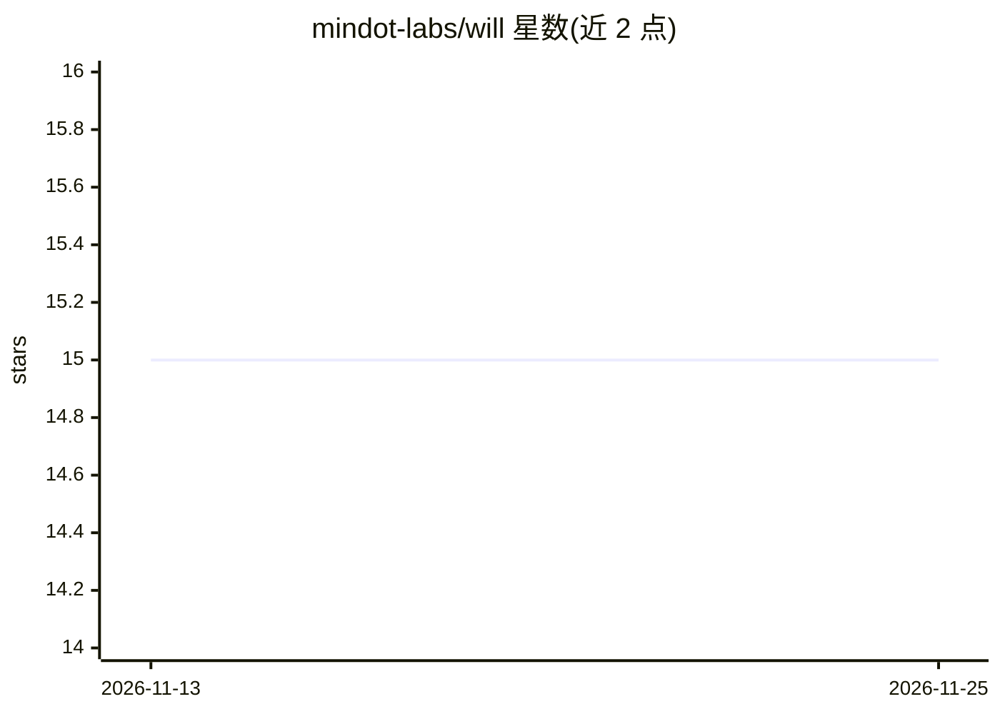

# mindot-labs/will

⭐ 15 · TypeScript · Apache-2.0 · 推送 2026-11-14 · [GitHub](https://github.com/mindot-labs/will) · [官网](https://mindot.io) · 组织维护

**持久化自主 Agent 引擎：40+ 认知引擎驱动，LLM 仅作组件**

一个用于构建持久化机器心智的引擎，由 38 个 faculty、学习型 agency pipeline 与五条感知通道组成，在确定性 tick 时钟上连续运行能量、睡眠、情绪、记忆、规划、社交认知与自我反思。LLM 仅在歧义或高风险时刻被调用，多数 tick 由引擎自身解析。心智状态通过可携带的 PMA 工件跨重启持久化并带重建保真度评分。以 npm 包与源码提供，支持 Node 18+/Bun 运行，默认 mock executive 无需 API key。

## 筛选速览

| 维度 | 判定 | 备注 |
|---|---|---|
| AI 角色 | `ai-ecosystem` | LLM/agent 周边工具 |
| 许可风险 | `permissive` | Apache-2.0 |
| 部署形态 | `self-host` | docker 或自建部署 |
| 模型依赖 | local-ok | 支持本地模型 |
| 硬件要求 | — | 无带数字的原话,不猜 |
| 安装摩擦 | `low` | 无编译、无系统依赖或容器化 |
| 成熟度 | — | 结构信号不足 |

## 能力要点

- 40+ 认知引擎在确定性 tick 时钟上运行，多数 tick 无需 LLM 推理
- PMA 持久化工件：跨重启携带特质、信念与习得技能，附重建保真度评分
- 六种嵌入面：SDK facade、Discord、WhatsApp、MCP host、MCP 工具能力、HTTP sidecar/Docker
- 无 API key 的 mock executive 快速启动（bun run examples/hello-will.ts）

## 适用场景

- 在 Node/TS 应用中嵌入一个跨会话持久化的自主心智
- 在 Discord/WhatsApp 服务器中运行一个可主动发言、记住成员的 bot
- 通过 MCP 把 Claude Desktop 等客户端接入持久心智，或让心智调用 MCP 工具
- 从 Python/Go/游戏服务器经 HTTP sidecar 驱动心智进程

## 场景标签

`Agent 框架` `Agent 记忆` · 领域:Agent 开发

## 证据(README 行号)

> L8: Will is a persistent, autonomous agent built from **40+ cognitive engines** — 38 faculties across seven systems, a l
> L75: Runs anywhere **Node 18+ or Bun** runs (the engine is Node-compatible; Bun is the primary target). **Six surfaces**
> L79: |**SDK facade**|a Node/TypeScript app embedding a mind|`import { Will } from '@mindot/will'`|

## 星数曲线

2026-11-13 15 → 2026-11-25 15（+0）

---
*卡片 v1 · prompt 1.4 · 生成 2026-11-18 · 置信度 high · 依据 README sha `7530074a9c70` · [字段定义](../../DATASET.md)*
