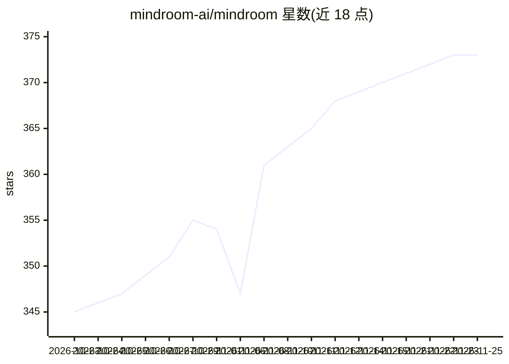

# mindroom-ai/mindroom

⭐ 373 · Python · Apache-2.0 · 推送 2026-11-24 · [GitHub](https://github.com/mindroom-ai/mindroom) · [官网](https://mindroom.chat) · 组织维护

**个人与团队的 AI agent 聊天应用：接入日历/邮件/文档等工具**

基于 Matrix 协议的开源 AI agent 平台：每个 agent 是 Matrix 上的真实用户，可连接 100+ 工具（Gmail、GitHub、Home Assistant、任意 MCP 服务器），支持多 agent 协作与路由、持久记忆（Mem0 + ChromaDB）、知识库 RAG、可接管的浏览器操作与桌面桥接。提供 uvx 一键运行、macOS 原生应用与 Helm/Kubernetes 部署路径，模型可按 agent/房间选择本地或云端，另有 hosted 版本。

## 筛选速览

| 维度 | 判定 | 备注 |
|---|---|---|
| AI 角色 | `ai-native` | 本体是模型或模型工具 |
| 许可风险 | `permissive` | Apache-2.0 |
| 部署形态 | `self-host` | docker 或自建部署 |
| 模型依赖 | local-ok | 支持本地模型 |
| 硬件要求 | — | 无带数字的原话,不猜 |
| 安装摩擦 | `low` | 无编译、无系统依赖或容器化 |
| 成熟度 | — | 结构信号不足 |

## 能力要点

- agent 作为 Matrix 用户存在，可通过桥接进入 Slack/Telegram/WhatsApp/Discord
- 每个 agent/房间/线程可独立指定模型，本地与云端混合路由
- 持久记忆、自动技能学习与可选知识图谱（Graphiti）
- 工具审批卡片、容器沙箱执行与 Matrix 端到端加密

## 适用场景

- 让 agent 帮我管理日历、待办并按语音下达指令
- 团队共享 agent 处理邮件分诊、周报与跨工具检索
- 敏感数据场景下用本地模型自托管整套服务
- 在聊天中让 agent 操作浏览器下单并在登录时接手

## 场景标签

`多智能体` `知识图谱` `RAG` `AI 助手` · 领域:Agent 开发

## 证据(README 行号)

> L20: Every agent is a real user on Matrix, the open chat standard, so you talk to it in MindRoom Chat, in any other Matr
> L118: - **Multi-agent orchestration** — define specialist agents and teams in `config.yaml` or the dashboard; built-in r
> L142: - **Model routing** — a different model per agent, room, or thread (`/model` and `/room_model`); route sensitive r

## 星数曲线

2026-10-23 345 → 2026-11-25 373（+28）

---
*卡片 v1 · prompt 1.4 · 生成 2026-11-25 · 置信度 mid · 依据 README sha `b7bdb849ba6f` · [字段定义](../../DATASET.md)*
