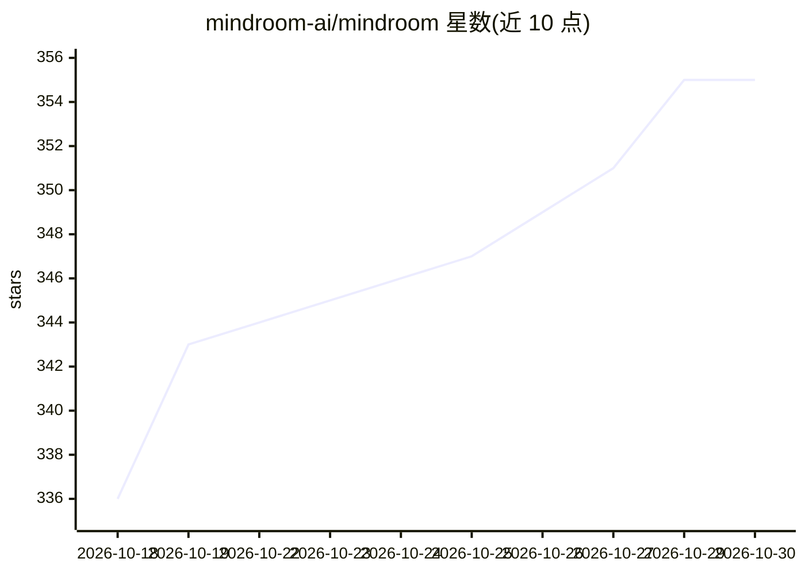

# mindroom-ai/mindroom

⭐ 355 · Python · Apache-2.0 · 推送 2026-10-29 · [GitHub](https://github.com/mindroom-ai/mindroom) · [官网](https://mindroom.chat) · 组织维护

**自托管个人/团队 AI agent 平台，Matrix 聊天应用承载**

开源（Apache 2.0）的 agent 平台：每个 agent 是 Matrix 上的真实用户，可在自有 MindRoom Chat 客户端或经桥接在 Slack/Telegram/WhatsApp/Discord 对话。功能含 100+ 工具接入（含任意 MCP 服务器）、持久记忆（Mem0+ChromaDB）、知识图谱与 RAG 知识库、可接管的真实浏览器、审批卡片、沙箱执行、定时任务与端到端加密。任意模型可选本地或云端，可全栈自托管，支持 uvx、PyPI、Homebrew、Docker、Kubernetes Helm 部署；另有 macOS 原生应用与托管版。

## 筛选速览

| 维度 | 判定 | 备注 |
|---|---|---|
| AI 角色 | `ai-native` | 本体是模型或模型工具 |
| 许可风险 | `permissive` | Apache-2.0 |
| 部署形态 | `self-host` | docker 或自建部署 |
| 模型依赖 | local-ok | 支持本地模型 |
| 硬件要求 | — | 无带数字的原话,不猜 |
| 安装摩擦 | `low` | 无编译、无系统依赖或容器化 |
| 成熟度 | `idea` | |

## 能力要点

- agent 以 Matrix 用户身份存在，经桥接接入 Slack/Telegram/WhatsApp/Discord
- 100+ 工具集成与任意 MCP 服务器接入
- 持久记忆、自动技能学习与 Graphiti 知识图谱
- 逐 agent 模型路由，可将敏感会话指向本地 Ollama

## 适用场景

- 个人事务代理：日历、笔记、行程、智能家居，语音操作
- 团队共享 agent：跨邮件/文档/代码检索、晨报、状态汇报
- 自托管全栈并按 agent 选择本地或云端模型
- 在已有聊天软件中直接与同一批 agent 对话

## 场景标签

`AI 助手` `RAG` `知识图谱` · 领域:对话与助手

## 证据(README 行号)

> L19: MindRoom gives you a personal agent for your calendar, notes, trips, and homelab, and shared agents for your team's
> L20: Every agent is a real user on Matrix, the open chat standard, so you talk to it in MindRoom Chat, in any other Matr
> L109: MindRoom builds its own client for the web, Mac, iPhone, iPad, and Android (in beta), so agents can show live tool

## 星数曲线

2026-10-18 336 → 2026-10-30 355（+19）

---
*卡片 v1 · prompt 1.4 · 生成 2026-10-21 · 置信度 high · 依据 README sha `5d891114c1b0` · [字段定义](../../DATASET.md)*
