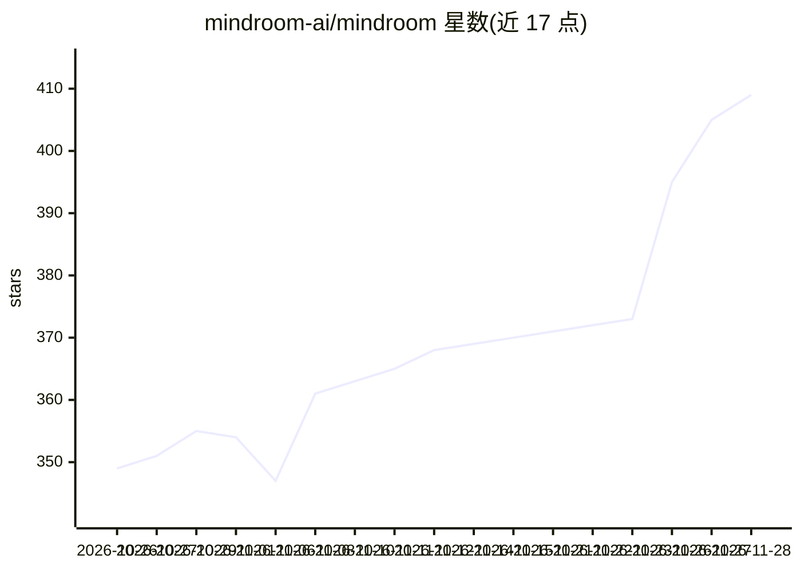

# mindroom-ai/mindroom

⭐ 409 · Python · Apache-2.0 · 推送 2026-11-27 · [GitHub](https://github.com/mindroom-ai/mindroom) · [官网](https://mindroom.chat) · 组织维护

**自托管的个人/团队 AI agent 聊天应用，接任意模型**

MindRoom 是一个开源 AI agent 平台：为个人与团队提供接入日历、笔记、邮件、文档等工具的 agent，每个 agent 以 Matrix 用户身份存在，可通过 MindRoom Chat、其他 Matrix 客户端或 Slack/Telegram/WhatsApp/Discord 桥接对话。支持按 agent 选择本地或云端模型、持久记忆（Mem0+ChromaDB）、知识库 RAG、工具审批、沙箱执行、定时任务与多 agent 协作。可自托管整套服务，也可仅在本机运行 agent，或使用托管版。

## 筛选速览

| 维度 | 判定 | 备注 |
|---|---|---|
| AI 角色 | `ai-native` | 本体是模型或模型工具 |
| 许可风险 | `permissive` | Apache-2.0 |
| 部署形态 | `self-host` | docker 或自建部署 |
| 模型依赖 | local-ok | 支持本地模型 |
| 硬件要求 | — | 无带数字的原话,不猜 |
| 安装摩擦 | `low` | 无编译、无系统依赖或容器化 |
| 成熟度 | — | 结构信号不足 |

## 能力要点

- agent 即 Matrix 用户，可桥接到 Slack/Telegram/WhatsApp/Discord
- 按 agent/房间/线程路由模型，本地与云端混合
- 100+ 工具集成与任意 MCP 服务器接入
- 持久记忆、知识图谱与自动技能学习

## 适用场景

- 用语音管理日历、提醒、待办和家庭琐事
- 让团队 agent 检索邮件、文档、工单并生成简报
- 自托管一套不把数据交给第三方公司的 agent 服务
- 让 agent 在自己的浏览器里完成下单等网页操作

## 场景标签

`多智能体` `RAG` `AI 助手` · 领域:Agent 开发

## 证据(README 行号)

> L5: **AI agents that know you and your work, in a chat app anyone can use.**
> L20: Every agent is a real user on Matrix, the open chat standard, so you talk to it in MindRoom Chat, in any other Matr

## 星数曲线

2026-10-26 349 → 2026-11-28 409（+60）

---
*卡片 v1 · prompt 1.4 · 生成 2026-11-28 · 置信度 high · 依据 README sha `4b2ebf498dc6` · [字段定义](../../DATASET.md)*
