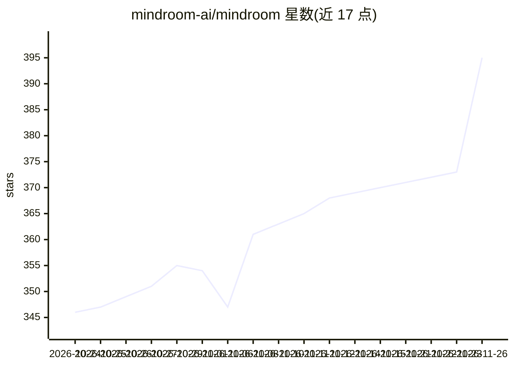

# mindroom-ai/mindroom

⭐ 395 · Python · Apache-2.0 · 推送 2026-11-25 · [GitHub](https://github.com/mindroom-ai/mindroom) · [官网](https://mindroom.chat) · 组织维护

**基于 Matrix 的个人/团队 AI agent 聊天应用，可自托管**

MindRoom 让用户在 Matrix 聊天客户端中运行个人与共享 AI agent：每个 agent 是 Matrix 上的真实用户，可接入日历、笔记、邮件、代码等 100+ 工具与任意 MCP 服务器，支持浏览器操作、桌面桥接、审批卡与交互式画布。每个 agent 可选不同模型（本地或云端），持久记忆存于本地磁盘，支持 Slack/Telegram/WhatsApp/Discord 桥接、定时任务、RAG 知识库与沙箱执行。可通过 uvx 命令、macOS 原生应用或托管版运行。

## 筛选速览

| 维度 | 判定 | 备注 |
|---|---|---|
| AI 角色 | `ai-native` | 本体是模型或模型工具 |
| 许可风险 | `permissive` | Apache-2.0 |
| 部署形态 | `self-host` | docker 或自建部署 |
| 模型依赖 | local-ok | 支持本地模型 |
| 硬件要求 | — | 无带数字的原话,不猜 |
| 安装摩擦 | `low` | 无编译、无系统依赖或容器化 |
| 成熟度 | — | 结构信号不足 |

## 能力要点

- 每个 agent 是 Matrix 真实用户，可经桥接接入 Slack/Telegram/WhatsApp/Discord
- 100+ 工具集成与任意 MCP 服务器，支持持久 Chromium 浏览器与桌面桥接
- 按 agent/房间/线程的模型路由，敏感房间可路由到本地 Ollama
- Mem0+ChromaDB 持久记忆、Graphiti 知识图谱与 RAG 知识库

## 适用场景

- 在聊天中管理日历、提醒、笔记并按语音指令操作
- 团队共享 agent 处理邮件分拣、状态汇总与文档检索
- 通过语音笔记控制智能家居并逐项审批 agent 动作
- 自托管整套 agent 栈，让隐私数据不离开本地

## 场景标签

`聊天机器人` `RAG` `知识图谱` · 领域:对话与助手

## 证据(README 行号)

> L19: MindRoom gives you a personal agent for your calendar, notes, trips, and homelab, and shared agents for your team's
> L20: Every agent is a real user on Matrix, the open chat standard, so you talk to it in MindRoom Chat, in any other Matr
> L96: Personal agents and shared team agents connect to 100+ tools, including email, calendar, Slack, Jira, GitHub, and a

## 星数曲线

2026-10-24 346 → 2026-11-26 395（+49）

---
*卡片 v1 · prompt 1.4 · 生成 2026-11-26 · 置信度 high · 依据 README sha `ca0e80078acb` · [字段定义](../../DATASET.md)*
