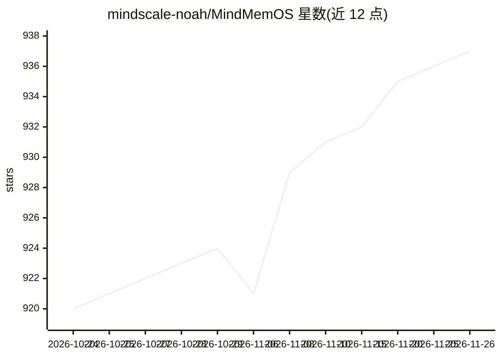

# mindscale-noah/MindMemOS

⭐ 937 · Python · 推送 2026-11-24 · [GitHub](https://github.com/mindscale-noah/MindMemOS) · [官网](https://mindmemos.cn) · 组织维护 · 中文 README

**为 AI agent 提供跨 agent 长期记忆存取的记忆操作系统层**

面向 agent 的记忆服务：以 FastAPI 服务形式部署（云端或本地自托管），通过 HTTP API、Python SDK/CLI 或 agent 插件三种方式接入，提供 add/search 等记忆接口。记忆按 schema 学习、离线整合（dreaming）与反馈持续演化，经验记忆可蒸馏为 Skill 候选，技能执行结果又回流记忆系统。支持 OpenClaw、DeepSeek Harness 等插件实现交互前召回、交互后回写；多模态模式默认关闭，开启后图像存于 S3/MinIO 并用多模态嵌入索引。本地依赖 Qdrant、Neo4j、Kafka 等 Docker 栈。

## 筛选速览

| 维度 | 判定 | 备注 |
|---|---|---|
| AI 角色 | `ai-ecosystem` | LLM/agent 周边工具 |
| 许可风险 | `none` | — |
| 部署形态 | `library` | 以包/库形式分发 |
| 模型依赖 | locked-api |  |
| 硬件要求 | — | 无带数字的原话,不猜 |
| 安装摩擦 | `low` | 无编译、无系统依赖或容器化 |
| 成熟度 | — | 结构信号不足 |

## 能力要点

- 跨 agent 可移植记忆：OpenClaw、Hermes、Claude Code、OpenHands 可共享同一长期记忆
- 自演化机制：schema 学习、dreaming 离线整合、交互反馈优化 add/search
- 经验记忆蒸馏为 Skill 候选，技能执行结果回流驱动技能演化
- 多模态记忆：图像存 S3/MinIO，SigLIP2 兼容嵌入索引，VLM 提取视觉事实（enhanced 模式）

## 适用场景

- 给多个 agent 挂载同一份用户画像与项目事实记忆
- 让 agent 在交互前自动召回相关记忆、交互后自动回写对话
- 积累跨任务经验与领域知识并蒸馏为可复用技能

## 场景标签

`Agent 记忆` · 领域:Agent 开发

## 证据(README 行号)

> L35:  Accurately remember user and task context and reuse it across agents; evolve memory through ongoing interactions, 
> L49: - **Portable across agents**: Persist user profiles, preferences, project facts, tool experience, and skill candida
> L53: - **Plugin integrations**: Connect MindMemOS to different agents and workflows through plugins that retrieve and in

## 星数曲线

2026-10-24 920 → 2026-11-26 937（+17）

---
*卡片 v1 · prompt 1.4 · 生成 2026-11-24 · 置信度 high · 依据 README sha `1bb0e5fc06b2` · [字段定义](../../DATASET.md)*
