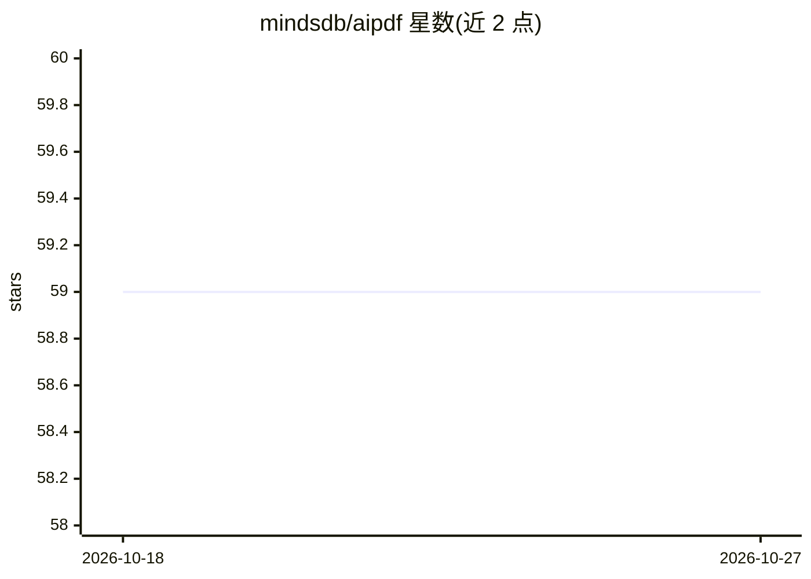

# mindsdb/aipdf

⭐ 59 · Python · MIT · 推送 2026-04-07 · [GitHub](https://github.com/mindsdb/aipdf) · 组织维护

**用多模态大模型把 PDF OCR 转为 Markdown 的 Python 库**

纯 Python 库，调用 OpenAI、llama3 及兼容的多模态生成式模型对 PDF 做数据提取并转换为 Markdown。默认先判断哪些页面可用传统文本解析处理，其余发给 LLM，可用 use_llm_for_all 强制全部走模型；对 LLM 的调用并行执行（线程版 ocr 与异步版 ocr_async），并发数可用环境变量控制。接受文件对象，兼容本地、URL、S3 等来源。仅依赖 openai 与 PyMuPDF 两个库，需 Python 3.7+，也支持通过 base_url 接入本地 Ollama 多模态模型。

## 筛选速览

| 维度 | 判定 | 备注 |
|---|---|---|
| AI 角色 | `ai-native` | 本体是模型或模型工具 |
| 许可风险 | `permissive` | MIT |
| 部署形态 | `library` | 以包/库形式分发 |
| 模型依赖 | local-ok | 支持本地模型 |
| 硬件要求 | — | 无带数字的原话,不猜 |
| 安装摩擦 | `low` | 无编译、无系统依赖或容器化 |
| 成熟度 | — | 结构信号不足 |

## 能力要点

- 按页面内容自动决定是否交给 LLM 处理，可强制全量走模型
- ocr 与 ocr_async 两种接口，LLM 调用并行执行且并发数可配
- 接受文件对象，支持本地文件、URL、S3 等来源
- 仅两个必需依赖（openai、PyMuPDF），支持自定义 prompt

## 适用场景

- 把 PDF 文档或论文转成 Markdown 便于下游处理
- 用自定义 prompt 从 PDF 中提取表格并输出 JSON
- 在本地通过 Ollama 多模态模型离线处理 PDF

## 场景标签

`OCR` `文档解析` · 领域:知识与检索

## 证据(README 行号)

> L3: AIPDF is a stand-alone, minimalistic, yet powerful pure Python library that leverages multi-modal gen AI models (Ope
> L20: By default, AIPDF attempts to determine which pages to send to the LLM based on their content and whether they can 

## 星数曲线

2026-10-18 59 → 2026-10-27 59（+0）

---
*卡片 v1 · prompt 1.4 · 生成 2026-10-24 · 置信度 high · 依据 README sha `befb6362a1d9` · [字段定义](../../DATASET.md)*
