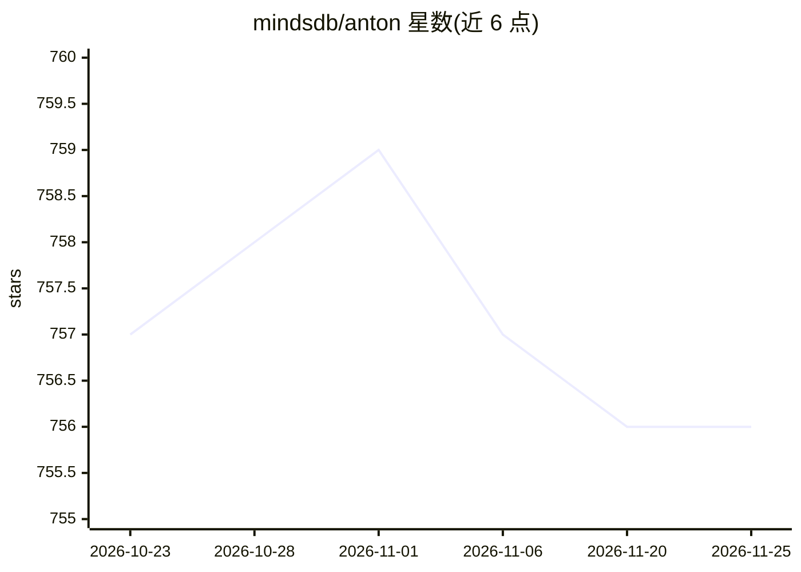

# mindsdb/anton

⭐ 756 · Python · MIT · 推送 2026-11-24 · [GitHub](https://github.com/mindsdb/anton) · [官网](https://mindsdb.github.io/anton/) · 组织维护

**开源通用 agent 框架：用户描述任务，agent 自主完成**

Anton 是驱动 MindsHub Cowork 的开源 agent harness，也可作为 CLI 独立运行于终端。用户描述目标结果，agent 自行规划并执行：写代码、抓网页、连接数据库与应用、生成仪表盘与报告、清理邮箱、自建集成（如 WhatsApp）。核心机制包括执行 scratchpad、多层记忆与持续学习、凭据保险库、隔离代码执行、默认启用的 web_search/web_fetch 工具（按 LLM 提供方路由，可配置 Exa/Brave 回退）。macOS/Windows 有安装包，CLI 通过脚本安装，MIT 许可，含匿名遥测（可关闭）。

## 筛选速览

| 维度 | 判定 | 备注 |
|---|---|---|
| AI 角色 | `ai-native` | 本体是模型或模型工具 |
| 许可风险 | `permissive` | MIT |
| 部署形态 | `desktop` | 安装包/桌面程序 |
| 模型依赖 | — | README 未给出锁定关系 |
| 硬件要求 | — | 无带数字的原话,不猜 |
| 安装摩擦 | `low` | 无编译、无系统依赖或容器化 |
| 成熟度 | — | 结构信号不足 |

## 能力要点

- 用户描述结果，agent 自主规划步骤并执行（报表、邮箱、集成、数据管道等）
- 执行 scratchpad 单一核心机制动态充当 web/DB/文件等工具
- 多层记忆与持续学习：episodes、rules、lessons、topics 存于 .anton 工作区
- 凭据保险库防止密钥暴露给 LLM；隔离代码执行环境

## 适用场景

- 把数据分析、报表生成、邮箱清理等一次性任务交给 agent 完成
- 定时监控数据源并自动执行工作流
- 让 agent 自行编写并运行第三方服务集成代码
- 连接数据库与应用，用自然语言查询自己的数据

## 场景标签

`Agent 框架` `数据分析` `工作流自动化` `代码生成` · 领域:Agent 开发

## 证据(README 行号)

> L14: Anton is the open-source agentic harness that powers **MindsHub Cowork** — a self-improving AI agent you can hand a
> L16: Hand it real work: create and send reports, clear your inbox, manage your calendar and CRM, book flights, and more.
> L60: The pattern is always the same: you describe the outcome, Anton figures out the steps. From one-off tasks to schedu

## 星数曲线

2026-10-23 757 → 2026-11-25 756（-1）

---
*卡片 v1 · prompt 1.4 · 生成 2026-11-25 · 置信度 mid · 依据 README sha `7febaaf7007b` · [字段定义](../../DATASET.md)*
