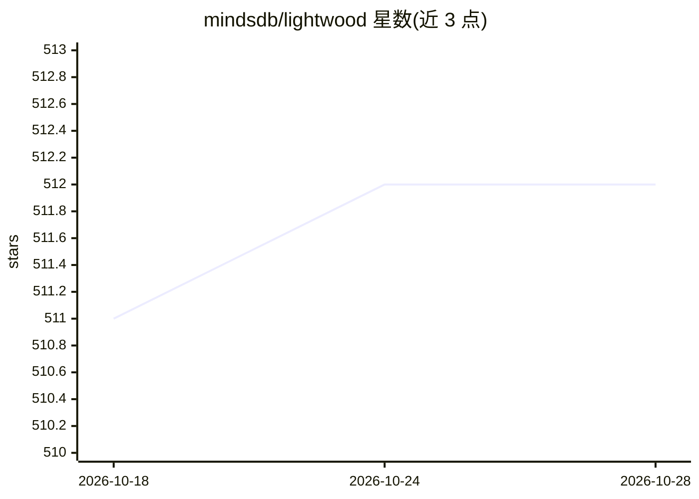

# mindsdb/lightwood

⭐ 512 · Python · GPL-3.0 · 推送 2026-08-28 · [GitHub](https://github.com/mindsdb/lightwood) · 组织维护

**面向开发者的 AutoML 框架：用 JSON-AI 声明式生成 ML 流水线**

Lightwood 是 MindsDB 维护的 AutoML 框架，用户通过 JSON-AI 声明式语法定义机器学习流水线，自动完成预处理清洗、特征工程（encoder）与模型构建训练（mixer）三步。支持数值、日期、类别、标签、文本、数组及多媒体等多种数据类型，含时间序列模式，基于 pandas.DataFrame 输入，predominantly 使用 PyTorch 实现，允许用户通过继承 BaseEncoder/BaseMixer 自定义各环节。以 pip 包分发，开发环境要求 Python >=3.8,<3.11，采用 GPL 许可并要求贡献者签署 CLI 协议。

## 筛选速览

| 维度 | 判定 | 备注 |
|---|---|---|
| AI 角色 | `ai-ecosystem` | LLM/agent 周边工具 |
| 许可风险 | `viral` | GPL-3.0 |
| 部署形态 | `library` | 以包/库形式分发 |
| 模型依赖 | — | README 未给出锁定关系 |
| 硬件要求 | — | 无带数字的原话,不猜 |
| 安装摩擦 | `low` | 无编译、无系统依赖或容器化 |
| 成熟度 | — | 结构信号不足 |

## 能力要点

- JSON-AI 声明式语法自动生成 ML 流水线 Python 代码
- 流水线抽象为清洗/编码器/混频器三步，各步均可自定义替换
- 支持多数据类型与时间序列模式，基于 PyTorch
- BYOM：用户可接入自己的模型架构

## 适用场景

- 从 DataFrame 快速自动生成预测模型，省去重复样板代码
- 通过 JSON-AI 语法定制流水线任一环节
- 接入自定义 cleaner/splitter/mixer 构建自有方案

## 场景标签

`MLOps` · 领域:训练与推理

## 证据(README 行号)

> L3: Lightwood is an AutoML framework that enables you to generate and customize machine learning pipelines declarative s
> L40: We predominantly use PyTorch based approaches, but can support other models.

## 星数曲线

2026-10-18 511 → 2026-10-28 512（+1）

---
*卡片 v1 · prompt 1.4 · 生成 2026-10-21 · 置信度 high · 依据 README sha `b8ade7a91480` · [字段定义](../../DATASET.md)*
