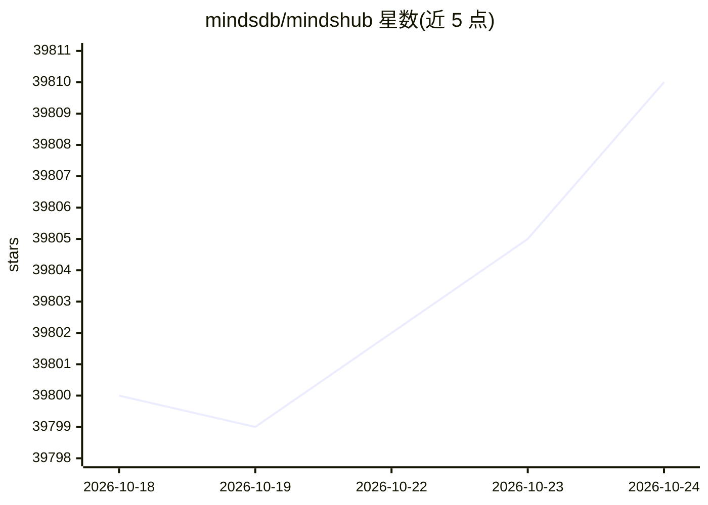

# mindsdb/mindshub

⭐ 39,811 · Makefile · MIT · 推送 2026-10-23 · [GitHub](https://github.com/mindsdb/mindshub) · [官网](https://mindshub.ai) · 组织维护 · 中文 README

**面向知识工作者的开源 Agent 工作台：可自选模型完成研究与开发任务**

开源 Agent 工作台，定位为完成知识工作与软件开发的统一工作空间，支持研究、分析、内容创作与软件开发。仓库为平台 superproject，聚合桌面/Web 应用、Agent 后端与数据引擎，可从源码构建运行。关键机制包括模型路由器（在多个闭源与开源模型间切换）、可互换的开源 agent harness（Anton 默认与 Hermes）、跨会话记忆、技能库、定时任务与制品发布。部署上支持本机、VPC、云端及隔离环境；Web 版免安装，macOS/Windows 提供桌面安装包，Linux 从源码构建。

## 筛选速览

| 维度 | 判定 | 备注 |
|---|---|---|
| AI 角色 | `ai-native` | 本体是模型或模型工具 |
| 许可风险 | `permissive` | MIT |
| 部署形态 | `desktop` | 安装包/桌面程序 |
| 模型依赖 | — | README 未给出锁定关系 |
| 硬件要求 | — | 无带数字的原话,不猜 |
| 安装摩擦 | `low` | 无编译、无系统依赖或容器化 |
| 成熟度 | — | 结构信号不足 |

## 动量与使用信号

- 维护:`active` — 距上次 push 3.6 天,年发版 22,381 位贡献者
- 涨星:近 1 天 **+0**(自 20261016 起算)
- 平台:WINDOWS / MACOS / LINUX / WEB · 协议:—

## 能力要点

- Model Router 在 Claude/GPT/Gemini 与 DeepSeek/Qwen/Kimi 间切换，无需逐家配 key
- 可互换的开源 agent harness：Anton（默认）与 Hermes，下拉切换
- 安全数据保险箱连接 BigQuery/Postgres/Gmail/Drive 等，凭据按连接隔离
- Agent 输出转为文档、仪表盘、应用并发布到在线 URL，支持定时任务与跨会话记忆

## 适用场景

- 用 Agent 自动化报告、监控、定时运营等多步骤读写工作
- 不写代码搭建内部 AI 工具（应用、仪表盘、文档）并分享给团队
- 在 VPC 或隔离环境中私有化部署 Agent 工作台
- 在同一工作区内切换多家模型供应商

## 场景标签

`AI 助手` `编码 Agent` `工作流自动化` · 领域:效率与自动化

## 证据(README 行号)

> L5: **MindsHub is an agent workspace for completing knowledge work and developing software, with open-source agent harne
> L22: MindsHub gives you the freedom to choose among models and providers instead of being locked into one ecosystem. Use
> L49: - **Model Router.** Switch between frontier models (Claude, GPT, Gemini) and open models (DeepSeek, Qwen, Kimi) wit

## 星数曲线

2026-10-18 39,800 → 2026-10-24 39,810（+10）

---
*卡片 v1 · prompt 1.4 · 生成 2026-10-18 · 置信度 high · 依据 README sha `2d05b724d1a1` · [字段定义](../../DATASET.md)*
