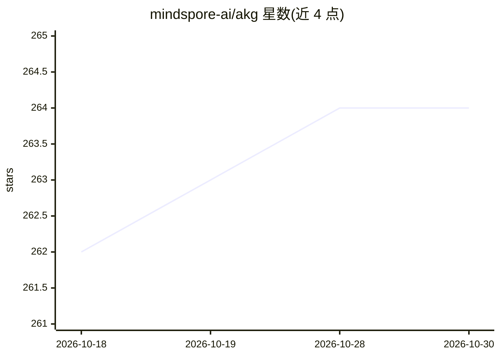

# mindspore-ai/akg

⭐ 264 · Python · Apache-2.0 · 推送 2026-10-29 · [GitHub](https://github.com/mindspore-ai/akg) · [官网](https://gitee.com/mindspore/akg) · 组织维护 · 中文 README

**深度学习算子自动生成与融合的编译器，面向 MindSpore 生态**

AKG 是深度学习编译器，对神经网络算子进行优化并提供特定模式的算子自动融合。当前包含两个子项目：AKG-MLIR 基于 MLIR 演进，提供 CPU/GPU/Ascend 完整算子编译 Pipeline；AKG-AGENT 是大模型驱动（Multi-agent）的算子生成工具，通过 LLM 生成 Triton-Ascend 与 SWFT DSL 并完成 kernel 编译，附带 AscendKernelBench 评测平台与算子知识库。各子项目支持独立安装构建，许可为 Apache 2.0，由 mindspore-ai 组织维护。

## 筛选速览

| 维度 | 判定 | 备注 |
|---|---|---|
| AI 角色 | `ai-ecosystem` | LLM/agent 周边工具 |
| 许可风险 | `permissive` | Apache-2.0 |
| 部署形态 | `None` |  |
| 模型依赖 | — | README 未给出锁定关系 |
| 硬件要求 | — | 无带数字的原话,不猜 |
| 安装摩擦 | `low` | 无编译、无系统依赖或容器化 |
| 成熟度 | — | 结构信号不足 |

## 能力要点

- 基于 MLIR 的 CPU/GPU/Ascend 完整算子编译 Pipeline
- AKG-AGENT：LLM + Multi-agent 框架自动生成算子 DSL 并编译
- 附带 AscendKernelBench 评测平台与算子知识库
- 支持 CPU、NVIDIA、V100/A100、Atlas 800T A2/A3、300I DUO 等硬件后端

## 适用场景

- 为深度学习框架生成与优化多后端算子 kernel
- 利用 LLM agent 框架自动生成昇腾等后端算子
- 对特定模式的算子做自动融合优化

## 场景标签

 · 领域:AI 编译器/算子优化

## 证据(README 行号)

> L5: AKG(Auto Kernel Generator)是一个深度学习编译器，用以对深度神经网络中的算子进行优化，并提供特定模式下的算子自动融合功能。
> L6: 从 2.4 版本之后，我们对 AKG 进行了全新升级，当前的 AKG 项目中，包含了 AKG-AGENT、AKG-MLIR 2个子项目，支持 CPU、NVIDIA、V100/A100、Atlas 800T A2/A3、300I DU

## 星数曲线

2026-10-18 262 → 2026-10-30 264（+2）

---
*卡片 v1 · prompt 1.4 · 生成 2026-10-22 · 置信度 high · 依据 README sha `23730785abea` · [字段定义](../../DATASET.md)*
