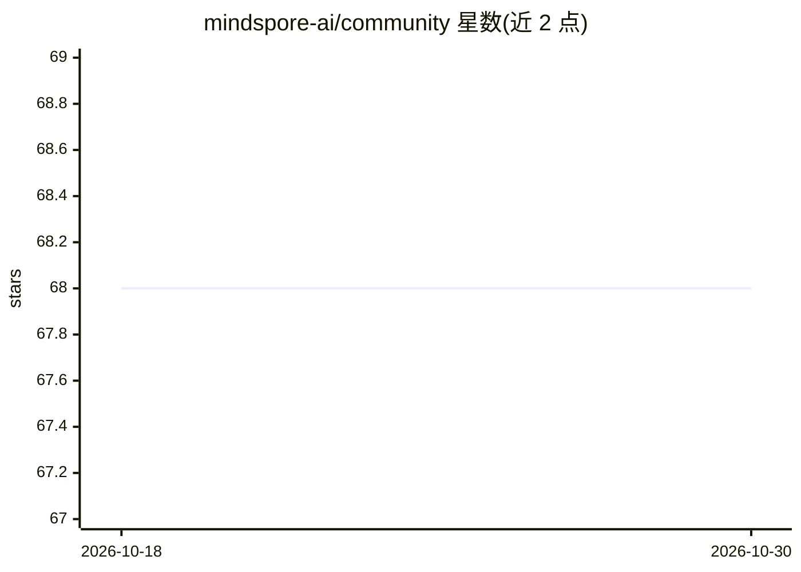

# mindspore-ai/community

⭐ 68 · Python · Apache-2.0 · 推送 2026-10-10 · [GitHub](https://github.com/mindspore-ai/community) · 组织维护 · 中文 README

**MindSpore 社区治理资料仓库：章程、CLA、行为准则等**

汇集 MindSpore 开源社区治理相关材料的仓库：包含社区章程（governance.md 草案，待 TSC 批准）、SIG 与工作组章程、行为准则、个人与企业贡献者许可协议（CLA）在线签署入口、CI 命令说明、IRC/Slack/邮件列表沟通渠道、CVE 安全报告途径及社区主题幻灯片模板。面向参与 MindSpore 框架贡献的开发者与企业，不含代码安装运行内容，采用 Apache 2.0 许可证。

## 筛选速览

| 维度 | 判定 | 备注 |
|---|---|---|
| AI 角色 | `ai-ecosystem` | LLM/agent 周边工具 |
| 许可风险 | `permissive` | Apache-2.0 |
| 部署形态 | `None` |  |
| 模型依赖 | — | README 未给出锁定关系 |
| 硬件要求 | — | 无带数字的原话,不猜 |
| 安装摩擦 | `low` | 无编译、无系统依赖或容器化 |
| 成熟度 | `idea` | |

## 能力要点

- 社区章程草案与 SIG/工作组章程文档
- 个人（ICLA）与企业（CCLA）贡献者许可协议签署流程
- CVE 安全报告途径与 CI 命令说明

## 适用场景

- 了解 MindSpore 社区治理结构与贡献流程
- 签署个人或企业 CLA 以参与贡献
- 查找社区沟通渠道与安全报告方式

## 场景标签

 · 领域:开源社区治理/AI 框架生态

## 证据(README 行号)

> L7: # MindSpore Community
> L9: This is the repo for all the community related materials. You can find the

## 星数曲线

2026-10-18 68 → 2026-10-30 68（+0）

---
*卡片 v1 · prompt 1.4 · 生成 2026-10-24 · 置信度 mid · 依据 README sha `6e83c6356e0f` · [字段定义](../../DATASET.md)*
