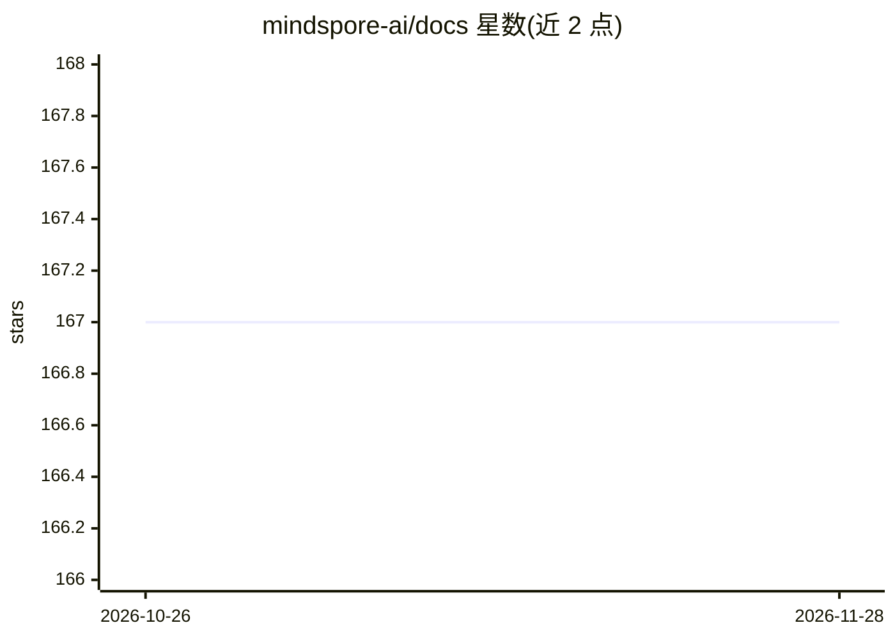

# mindspore-ai/docs

⭐ 167 · Jupyter Notebook · Apache-2.0 · 推送 2026-11-25 · [GitHub](https://github.com/mindspore-ai/docs) · 组织维护 · 中文 README

**MindSpore 框架官方文档源文件库：教程与 API 文档**

该仓库托管 MindSpore 官网的安装指南、教程及 API 文档源文件，内容覆盖 MindSpore、Lite、Transformers、Quantum 等组件。文档使用 Sphinx 工具构建，可分别生成中英文 HTML 页面；构建 API 文档前需先安装对应的 MindSpore 模块并克隆相关仓库、配置环境变量。仓库接受文档贡献，需遵循写作规范与流程规则，问题与建议通过 Issues 提交。

## 筛选速览

| 维度 | 判定 | 备注 |
|---|---|---|
| AI 角色 | `ai-knowledge` | 知识聚合/清单类 |
| 许可风险 | `permissive` | Apache-2.0 |
| 部署形态 | `library` | 以包/库形式分发 |
| 模型依赖 | — | README 未给出锁定关系 |
| 硬件要求 | — | 无带数字的原话,不猜 |
| 安装摩擦 | `low` | 无编译、无系统依赖或容器化 |
| 成熟度 | — | 结构信号不足 |

## 能力要点

- 提供安装指南、教程与 API 配置的文档源文件
- 基于 Sphinx 构建中英文 API 文档（make html）
- 覆盖 MindSpore、Lite、Transformers、Golden Stick、Quantum、MindScience 等组件
- 中英文文档通过 Makefile 配置分别构建

## 适用场景

- 查看或参与编写 MindSpore 官方教程与 API 文档
- 本地构建中英文文档站点用于阅读或校对
- 为 MindSpore 各组件文档提交修改贡献

## 场景标签

`教程课程` · 领域:学习与行业

## 证据(README 行号)

> L9: This project provides the source files of the installation guide, tutorials, and other documents, as well as API con
> L28: MindSpore tutorials and API documentation can be generated by the Sphinx tool. Before building API documentation fo

## 星数曲线

2026-10-26 167 → 2026-11-28 167（+0）

---
*卡片 v1 · prompt 1.4 · 生成 2026-11-27 · 置信度 high · 依据 README sha `484d23682dab` · [字段定义](../../DATASET.md)*
