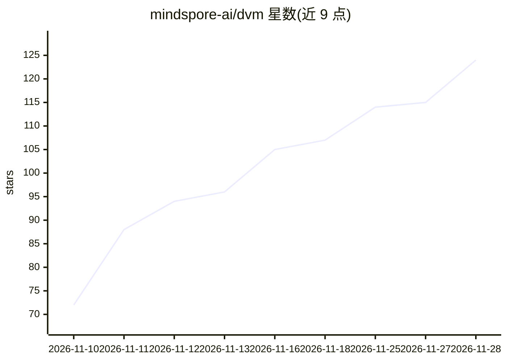

# mindspore-ai/dvm

⭐ 124 · C++ · Apache-2.0 · 推送 2026-11-27 · [GitHub](https://github.com/mindspore-ai/dvm) · 组织维护 · 中文 README

**面向动态负载的微秒级实时算子编译执行框架**

DVM（Device Virtual Machine）在运行时依据算子的具体形状编译并执行深度神经网络中的手写或融合算子，原生支持动态形状与动态图场景下的算子融合，也覆盖静态图融合与自定义手写算子等常规优化路径。主机编译器将算子图翻译为 tile 级字节码，由设备虚拟机解释执行；提供 Python 与 C++ 接口，供下游框架（MindSpore、TorchNPU）在图模式与 eager 模式下接入。安装需 Linux、CANN 8.5+、C++17 编译器，从源码构建 wheel。

## 筛选速览

| 维度 | 判定 | 备注 |
|---|---|---|
| AI 角色 | `ai-ecosystem` | LLM/agent 周边工具 |
| 许可风险 | `permissive` | Apache-2.0 |
| 部署形态 | `library` | 以包/库形式分发 |
| 模型依赖 | — | README 未给出锁定关系 |
| 硬件要求 | — | 无带数字的原话,不猜 |
| 安装摩擦 | `medium` | 含编译或系统依赖之一 |
| 成熟度 | — | 结构信号不足 |

## 能力要点

- 基于运行时形状生成算子，实现形状特定优化
- tile 级字节码由设备虚拟机解释执行
- 支持静态图、动态形状与 eager 执行三种模式的算子融合
- 提供 Python 与 C++ 两套接口供下游框架集成

## 适用场景

- 为动态形状模型工作负载做实时算子编译与融合
- 通过 @dvm.kernel 编写自定义算子并在 Ascend/GPU 上执行
- 在 TorchNPU 中启用图模式与 eager 模式的算子融合
- 以 C++ 头文件与 libdvm.a 集成到自有推理路径

## 场景标签

`推理引擎` `代码生成` · 领域:编码与开发

## 证据(README 行号)

> L22: compilation and execution. It compiles and executes handwritten or fused operators in deep neural networks at runti
> L41: - **Python and C++ interfaces:** Express custom operators and fused computations through Python or C++, and integra
> L116: For graph-mode and eager-mode fusion in TorchNPU, follow the integration guide.

## 星数曲线

2026-11-10 72 → 2026-11-28 124（+52）

---
*卡片 v1 · prompt 1.4 · 生成 2026-11-28 · 置信度 high · 依据 README sha `d48bea2997d0` · [字段定义](../../DATASET.md)*
