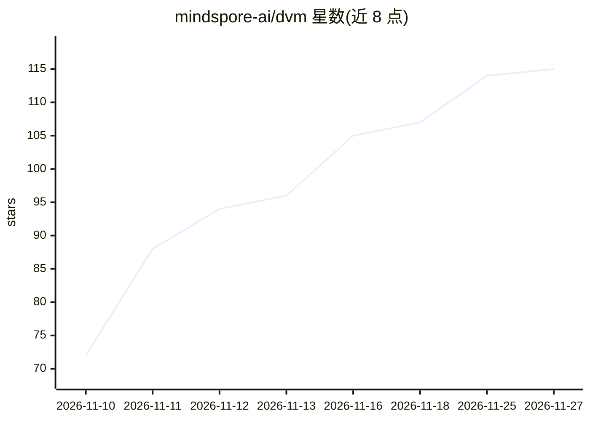

# mindspore-ai/dvm

⭐ 115 · C++ · Apache-2.0 · 推送 2026-11-26 · [GitHub](https://github.com/mindspore-ai/dvm) · 组织维护 · 中文 README

**微秒级实时 AI 算子编译与执行框架**

面向深度神经网络算子的运行时编译框架：基于执行时的具体 shape 生成算子，主机编译器将算子图翻译为 tile 级字节码，由设备虚拟机解释执行，原生支持动态 shape、动态图场景下的高性能算子融合，也覆盖静态图融合与手写算子。被 MindSpore 和 TorchNPU 用作图模式与 eager 模式的自动算子融合。支持华为昇腾 NPU（c220/c310 架构）与 NVIDIA GPU（V100 及更新）。提供 Python 与 C++ 接口，需从源码构建。

## 筛选速览

| 维度 | 判定 | 备注 |
|---|---|---|
| AI 角色 | `ai-ecosystem` | LLM/agent 周边工具 |
| 许可风险 | `permissive` | Apache-2.0 |
| 部署形态 | `library` | 以包/库形式分发 |
| 模型依赖 | — | README 未给出锁定关系 |
| 硬件要求 | — | 无带数字的原话,不猜 |
| 安装摩擦 | `high` | 编译与系统依赖俱全 |
| 成熟度 | — | 结构信号不足 |

## 能力要点

- 基于运行时 shape 的实时算子编译，支持动态 shape 与动态图融合
- tile 级字节码 + 设备虚拟机解释执行
- 被 MindSpore 与 TorchNPU 用于自动算子融合
- 提供 Python/C++ 双接口，支持昇腾 NPU 与 NVIDIA GPU

## 适用场景

- 为深度学习框架接入动态 shape 场景的算子融合
- 开发与执行自定义手写算子
- 在昇腾或 NVIDIA GPU 上做静态图融合优化

## 场景标签

`推理引擎` · 领域:训练与推理

## 证据(README 行号)

> L21: DVM (Device Virtual Machine) is currently the industry's only framework for microsecond-scale real-time AI operator
> L27: TorchNPU for automatic operator fusion in graph and eager modes.

## 星数曲线

2026-11-10 72 → 2026-11-27 115（+43）

---
*卡片 v1 · prompt 1.4 · 生成 2026-11-17 · 置信度 mid · 依据 README sha `8c16397f6a98` · [字段定义](../../DATASET.md)*
