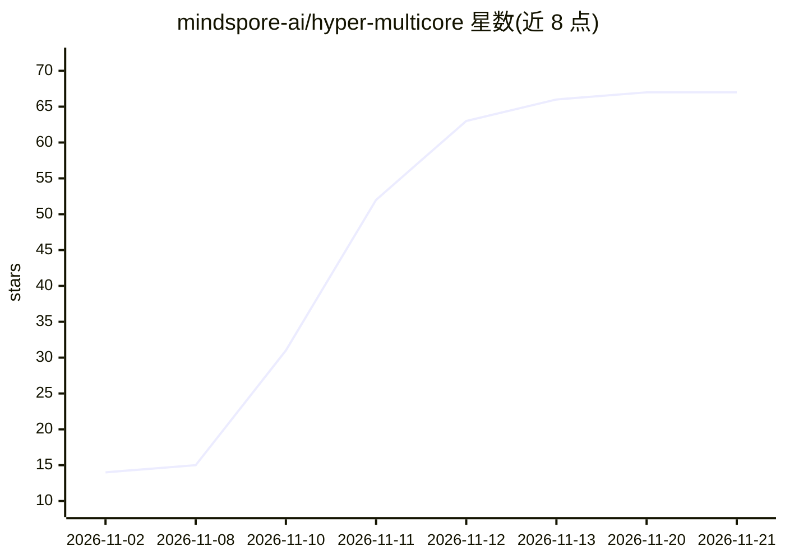

# mindspore-ai/hyper-multicore

⭐ 67 · Python · Apache-2.0 · 推送 2026-11-20 · [GitHub](https://github.com/mindspore-ai/hyper-multicore) · 组织维护 · 中文 README

**华为昇腾超节点 Megakernel 开发框架（MoE/路由/混合算子）**

面向 Huawei Ascend NPU 的 Megakernel 开发框架，为 MegaMoE（push/pull 专家并行前向反向）、MegaGate（自动求导的文本/视觉专家路由）与 MegaMHC（残差流混合算子）提供 Ascend 多核算子及 PyTorch 运行时，在 AI Core 上实现通信与计算重叠，并管理 SHMEM 通信资源；附带 kernel profiling 与 tensor dump 诊断工具。要求 Linux、Ascend NPU 及兼容的 torch-npu/CANN/驱动环境，通过 wheel 安装（需先激活 native 路径），可从源码构建与运行 CPU/NPU 测试。

## 筛选速览

| 维度 | 判定 | 备注 |
|---|---|---|
| AI 角色 | `ai-ecosystem` | LLM/agent 周边工具 |
| 许可风险 | `permissive` | Apache-2.0 |
| 部署形态 | `library` | 以包/库形式分发 |
| 模型依赖 | — | README 未给出锁定关系 |
| 硬件要求 | — | 无带数字的原话,不猜 |
| 安装摩擦 | `low` | 无编译、无系统依赖或容器化 |
| 成熟度 | — | 结构信号不足 |

## 能力要点

- MegaMoE 专家并行前向与反向计算（push/pull 分发）
- MegaGate 支持自动求导的文本/视觉专家路由
- AI Core 上通信与计算重叠，管理 SHMEM 通信资源
- kernel profiling 与 tensor dump 诊断工具

## 适用场景

- 在 Ascend NPU 上以 Megakernel 方式运行 MoE 训练与推理算子
- 在昇腾超节点环境开发/调试专家路由与混合算子
- 通过 profiling 与 tensor dump 定位算子性能与数值问题

## 场景标签

 · 领域:AI 基础设施/算子与运行时

## 证据(README 行号)

> L5: HyperMulticore 为 MegaMoE、MegaGate 和 MegaMHC 提供 Ascend 多核算子及 PyTorch 运行时，
> L8: - **MegaMoE**：支持 push/pull 分发的专家并行前向与反向计算。
> L15: 需要 Linux、Ascend NPU、与制品标签匹配的 Python/CPU 架构，以及彼此兼容的 Torch/torch-npu、CANN 和驱动。

## 星数曲线

2026-11-02 14 → 2026-11-21 67（+53）

---
*卡片 v1 · prompt 1.4 · 生成 2026-11-18 · 置信度 high · 依据 README sha `06406df5cb15` · [字段定义](../../DATASET.md)*
