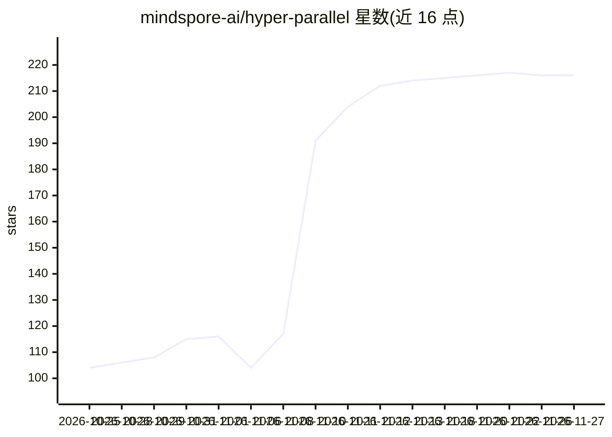

# mindspore-ai/hyper-parallel

⭐ 216 · Python · Apache-2.0 · 推送 2026-11-26 · [GitHub](https://github.com/mindspore-ai/hyper-parallel) · 组织维护 · 中文 README

**面向昇腾 SuperPoD 集群的大模型分布式训练加速框架**

为昇腾 SuperPoD 提供分布式并行训练加速的框架：通过声明式接口将并行、重计算与 offload 从模型代码解耦注入，直接读取 Hugging Face 模型配置与预训练权重并复用 Transformers 实现；支持 CPU DRAM 与 NPU HBM 池化管理、拓扑感知调度、通信路径规划与 FP8 混合精度训练，并提供覆盖计算/通信/数据预处理的端到端确定性模式。面向在昇腾集群上训练大语言与多模态模型的开发者，训练以 torchrun 启动，同时提供 PyTorch 风格核心 API（fully_shard、init_device_mesh）。安装方式指向安装指南，README 未给出具体命令。

## 筛选速览

| 维度 | 判定 | 备注 |
|---|---|---|
| AI 角色 | `ai-ecosystem` | LLM/agent 周边工具 |
| 许可风险 | `permissive` | Apache-2.0 |
| 部署形态 | `None` |  |
| 模型依赖 | locked-api |  |
| 硬件要求 | — | 无带数字的原话,不猜 |
| 安装摩擦 | `low` | 无编译、无系统依赖或容器化 |
| 成熟度 | — | 结构信号不足 |

## 能力要点

- 声明式注入并行/重计算/offload，与模型代码解耦
- 兼容 Hugging Face 生态，直接读取配置与预训练权重
- 端到端确定性训练与位对齐校验，可检测 SDC
- FP8 混合精度、DRAM/HBM 池化管理与拓扑感知调度

## 适用场景

- 在昇腾 SuperPoD 上训练 Qwen3/DeepSeek/Kimi 等大模型
- 基于 Hugging Face 模型实现做分布式并行改造
- 需要可复现训练结果或检测静默数据损坏的场景

## 场景标签

`模型训练` · 领域:训练与推理

## 证据(README 行号)

> L23: HyperParallel provides distributed parallel acceleration for Ascend SuperPoDs. Designed for resource pooling, peer-
> L29: - **Hugging Face ecosystem compatibility**: HyperParallel reads Hugging Face model configurations and pretrained we

## 星数曲线

2026-10-25 104 → 2026-11-27 216（+112）

---
*卡片 v1 · prompt 1.4 · 生成 2026-11-27 · 置信度 high · 依据 README sha `5e3fcb136041` · [字段定义](../../DATASET.md)*
