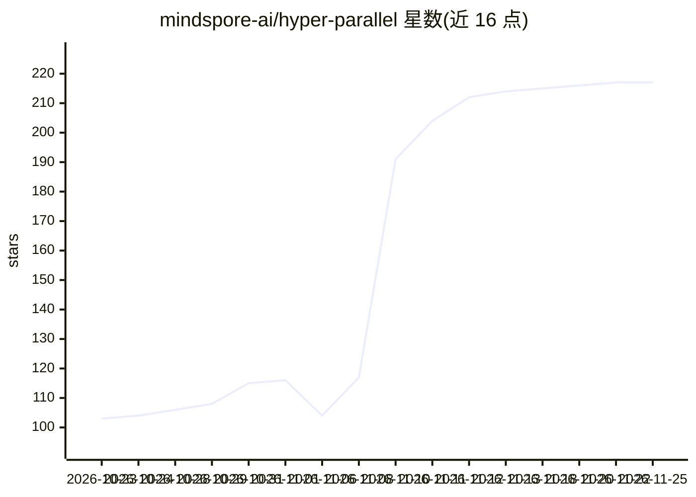

# mindspore-ai/hyper-parallel

⭐ 217 · Python · Apache-2.0 · 推送 2026-11-24 · [GitHub](https://github.com/mindspore-ai/hyper-parallel) · 组织维护 · 中文 README

**面向 Ascend SuperPoD 集群的分布式训练加速框架**

为 Ascend SuperPoD 提供分布式并行训练加速的框架，覆盖集群级并行与片上多核并行：支持 CPU DRAM 与 NPU HBM 池化管理、拓扑感知调度、通信路径规划与 FP8 混合精度训练。通过声明式接口将并行、重计算、offload 从模型代码中解耦注入；直接读取 Hugging Face 模型配置与权重，复用 Transformers 模型实现；支持计算/通信/数据预处理/随机数全链路确定性以复现训练结果。安装方法见官方安装指南，发布 wheels 提供于 GitHub Releases。

## 筛选速览

| 维度 | 判定 | 备注 |
|---|---|---|
| AI 角色 | `ai-ecosystem` | LLM/agent 周边工具 |
| 许可风险 | `permissive` | Apache-2.0 |
| 部署形态 | `None` |  |
| 模型依赖 | locked-api |  |
| 硬件要求 | — | 无带数字的原话,不猜 |
| 安装摩擦 | `low` | 无编译、无系统依赖或容器化 |
| 成熟度 | — | 结构信号不足 |

## 能力要点

- 声明式注入并行/重计算/offload，与模型代码解耦
- 直接读取 Hugging Face 配置与权重，复用 Transformers 实现
- 端到端确定性训练与 bitwise 对齐校验
- 支持 Qwen3、DeepSeek-V3/V4.1、Kimi-K2.6 等模型

## 适用场景

- 在 Ascend SuperPoD 集群上训练大语言与多模态模型
- 对 Hugging Face 模型执行 SPMD/MPMD 并行改造
- 需要确定性训练以复现结果或检测 SDC 的场景
- CPU DRAM 与 NPU HBM 池化管理的大规模训练

## 场景标签

`模型训练` · 领域:训练与推理

## 证据(README 行号)

> L23: HyperParallel provides distributed parallel acceleration for Ascend SuperPoDs. Designed for resource pooling, peer-
> L29: - **Hugging Face ecosystem compatibility**: HyperParallel reads Hugging Face model configurations and pretrained we

## 星数曲线

2026-10-23 103 → 2026-11-25 217（+114）

---
*卡片 v1 · prompt 1.4 · 生成 2026-11-25 · 置信度 high · 依据 README sha `c66194128e97` · [字段定义](../../DATASET.md)*
