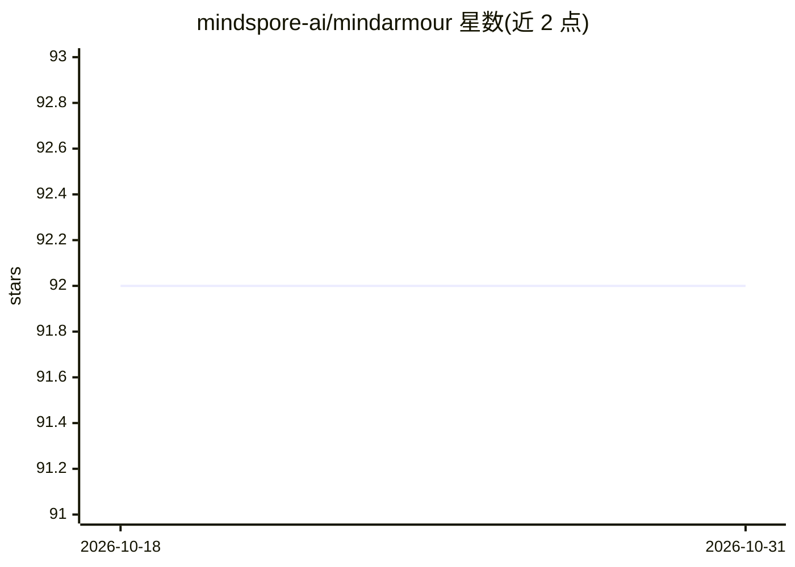

# mindspore-ai/mindarmour

⭐ 92 · Python · Apache-2.0 · 推送 2026-10-26 · [GitHub](https://github.com/mindspore-ai/mindarmour) · 组织维护 · 中文 README

**面向 MindSpore 用户的模型安全与可信度增强工具箱**

MindSpore 生态的模型安全工具箱，v2.0 含三大模块：对抗鲁棒性（对抗样本生成/检测、模型防御与评估）、AI 模型模糊测试（以神经元覆盖率增益引导生成样本、探索模型错误行为）、隐私保护与评估（基于高斯机制的差分隐私优化器 SGD/Momentum/Adam，RDP 与 ZCDP 预算监控，成员推断评估隐私泄露风险）。通过源码编译或 pip 安装 whl 包，需与 MindSpore 版本一致，硬件平台支持 Ascend、GPU 或 CPU。

## 筛选速览

| 维度 | 判定 | 备注 |
|---|---|---|
| AI 角色 | `ai-ecosystem` | LLM/agent 周边工具 |
| 许可风险 | `permissive` | Apache-2.0 |
| 部署形态 | `library` | 以包/库形式分发 |
| 模型依赖 | — | README 未给出锁定关系 |
| 硬件要求 | — | 无带数字的原话,不猜 |
| 安装摩擦 | `low` | 无编译、无系统依赖或容器化 |
| 成熟度 | — | 结构信号不足 |

## 能力要点

- 对抗样本生成、检测与模型防御、鲁棒性评估
- 以神经元覆盖率增益引导的 AI 模型模糊测试
- 差分隐私优化器（SGD/Momentum/Adam，高斯机制，RDP/ZCDP 预算监控）
- 基于成员推断的隐私泄露评估

## 适用场景

- 评估模型对对抗样本的鲁棒性并做防御增强
- 对深度学习模型做安全模糊测试发现错误行为
- 训练时用差分隐私保护数据隐私
- 评估模型泄露训练数据隐私的风险

## 场景标签

`网络安全` · 领域:学习与行业

## 证据(README 行号)

> L9: MindArmour focus on security and privacy of artificial intelligence. It is committed to enhancing the trustworthines
> L15: Adversarial robustness module is designed for evaluating the robustness of the model against adversarial examples, 
> L37: Differential Privacy Training Module implements the differential privacy optimizer. Currently, `SGD`, `Momentum` an

## 星数曲线

2026-10-18 92 → 2026-10-31 92（+0）

---
*卡片 v1 · prompt 1.4 · 生成 2026-10-23 · 置信度 high · 依据 README sha `2e5dd08c4a65` · [字段定义](../../DATASET.md)*
