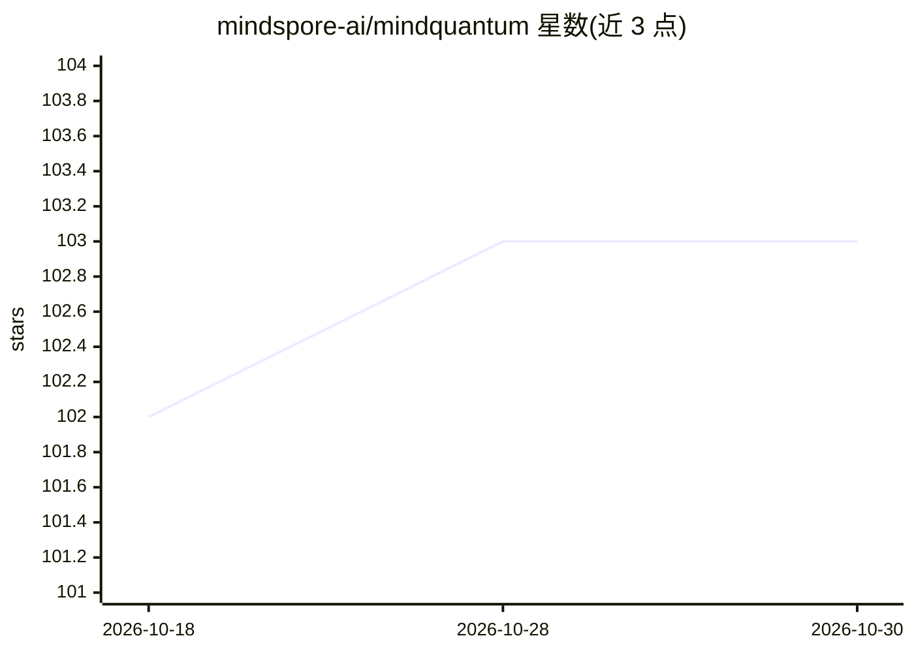

# mindspore-ai/mindquantum

⭐ 103 · Python · Apache-2.0 · 推送 2026-10-27 · [GitHub](https://github.com/mindspore-ai/mindquantum) · [官网](https://gitee.com/mindspore/mindquantum) · 组织维护 · 中文 README

**面向科研与教学的量子机器学习框架：构建与训练量子神经网络**

基于 MindSpore 的量子计算框架，面向 NISQ 算法实现：结合高性能量子电路模拟器与 MindSpore 的并行自动微分能力，用于量子机器学习、量子化学模拟与量子优化问题。提供参数化量子电路构建、量子神经网络训练、含噪声电路模拟、量子比特映射与电路等价性检查等功能，面向研究人员与师生设计算法验证平台。安装支持 pip、源码编译（Linux/Windows/macOS）与 Docker，CPU 模拟器基于 OpenMP 并行（每 8192 振幅一线程），可选 GPU 构建。

## 筛选速览

| 维度 | 判定 | 备注 |
|---|---|---|
| AI 角色 | `ai-native` | 本体是模型或模型工具 |
| 许可风险 | `permissive` | Apache-2.0 |
| 部署形态 | `library` | 以包/库形式分发 |
| 模型依赖 | — | README 未给出锁定关系 |
| 硬件要求 | — | 无带数字的原话,不猜 |
| 安装摩擦 | `high` | 编译与系统依赖俱全 |
| 成熟度 | — | 结构信号不足 |

## 能力要点

- 参数化量子电路构建与量子神经网络训练
- 含噪声电路模拟与噪声模拟器
- CPU 模拟器 OpenMP 并行，可选 CUDA GPU 构建
- 配套初/中/高级教程与算法案例库（Grover、Shor、VQE 等）

## 适用场景

- 用量子神经网络做分类或量子化学 VQE 计算
- 科研与教学中快速设计并验证量子算法
- 构建含噪声的 NISQ 变分量子电路实验

## 场景标签

`科研工具` · 领域:学习与行业

## 证据(README 行号)

> L19: MindQuantum is a new-generation quantum computing framework based on MindSpore, focusing on the implementation of N
> L61: ham = Hamiltonian(-QubitOperator("Z0 Z1"))

## 星数曲线

2026-10-18 102 → 2026-10-30 103（+1）

---
*卡片 v1 · prompt 1.4 · 生成 2026-10-23 · 置信度 high · 依据 README sha `6f18304dca94` · [字段定义](../../DATASET.md)*
