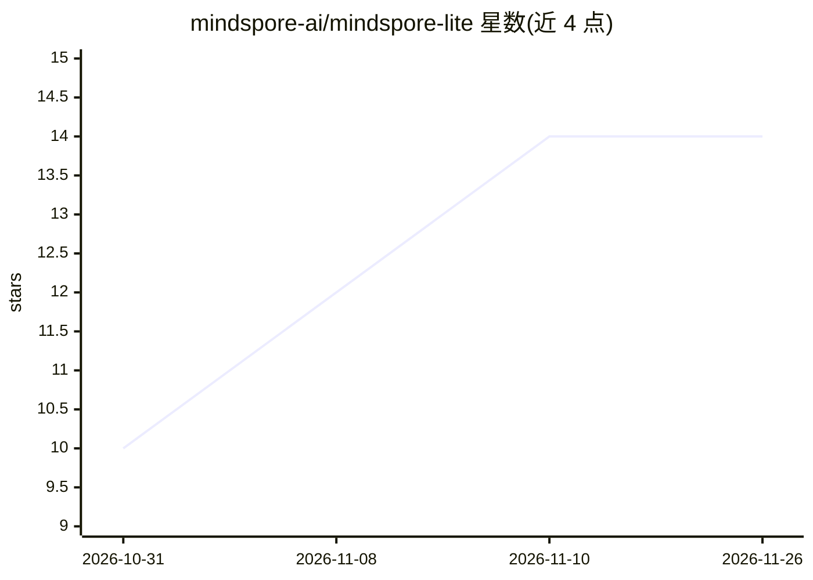

# mindspore-ai/mindspore-lite

⭐ 14 · C++ · Apache-2.0 · 推送 2026-11-20 · [GitHub](https://github.com/mindspore-ai/mindspore-lite) · 组织维护 · 中文 README

**面向端边云的轻量级 AI 推理引擎，支持多硬件部署**

MindSpore Lite 为不同硬件设备提供轻量级推理加速：将 MindSpore/ONNX/TF 等框架模型转换为 .mindir（云端 Ascend/CPU）或 .ms（端侧 Kirin NPU/Arm CPU）格式，通过 Python/C++/Java API 执行推理。内置 NNACL 算子库与模型压缩、训练后量化能力，另提供 MindSpore Lite Micro 超轻量方案用于手表、耳机等场景及云侧 Lite Boost 加速组件。面向算法工程师与数据科学家，需从源码编译动态库或 wheel 包使用。

## 筛选速览

| 维度 | 判定 | 备注 |
|---|---|---|
| AI 角色 | `ai-ecosystem` | LLM/agent 周边工具 |
| 许可风险 | `permissive` | Apache-2.0 |
| 部署形态 | `None` |  |
| 模型依赖 | — | README 未给出锁定关系 |
| 硬件要求 | — | 无带数字的原话,不猜 |
| 安装摩擦 | `low` | 无编译、无系统依赖或容器化 |
| 成熟度 | — | 结构信号不足 |

## 能力要点

- 模型转换工具：MindSpore/ONNX/TF 模型转 .mindir 或 .ms 格式
- Python/C++/Java 三种推理 API，覆盖端侧与云侧
- 内置 NNACL 算子库，支持 CPU、NNRt、华为 Ascend 等硬件
- MindSpore Lite Micro 超轻量方案面向智能手表、耳机等设备

## 适用场景

- 在华为 Ascend 或 X86/Arm CPU 上部署 LLM、视觉等模型推理
- 将训练模型转换后在手机（HarmonyOS/Android）端侧运行
- 在手表、耳机等极端资源受限设备上做超轻量推理

## 场景标签

`推理引擎` `模型量化` · 领域:训练与推理

## 证据(README 行号)

> L5: MindSpore Lite provides lightweight AI inference acceleration capabilities for different hardware devices, enabling 
> L27:  MindSpore Lite supports the conversion of models serialized from various AI frameworks such as MindSpore, ONNX, TF
> L35:  MindSpore Lite provides three APIs: Python, C++, and Java, and complete usage cases for the corresponding APIs:

## 星数曲线

2026-10-31 10 → 2026-11-26 14（+4）

---
*卡片 v1 · prompt 1.4 · 生成 2026-11-18 · 置信度 high · 依据 README sha `23c9bae3b7e5` · [字段定义](../../DATASET.md)*
