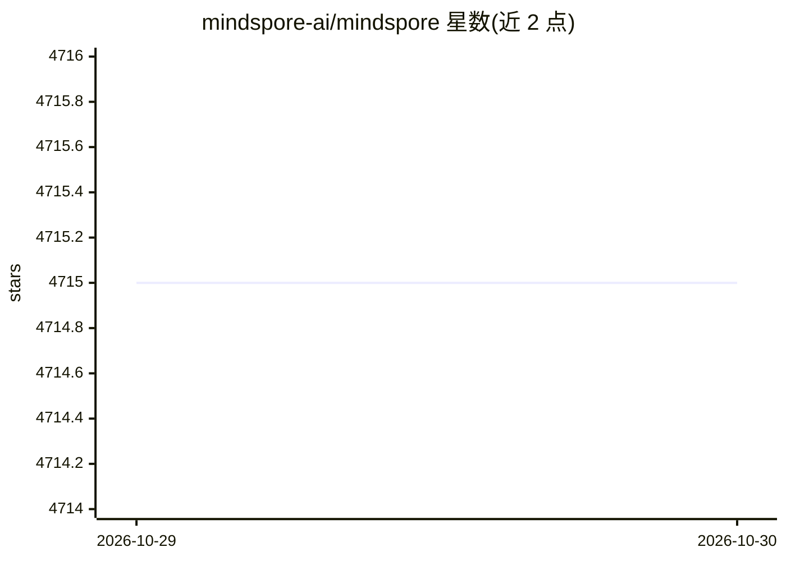

# mindspore-ai/mindspore

⭐ 4,715 · C++ · Apache-2.0 · 推送 2026-10-28 · [GitHub](https://github.com/mindspore-ai/mindspore) · [官网](https://gitee.com/mindspore/mindspore) · 组织维护 · 中文 README

**华为开源的深度学习训练/推理框架，覆盖端边云**

面向数据科学家与算法工程师的深度学习训练/推理框架，可用于移动、边缘与云场景。核心机制包括基于源码转换（ST）的自动微分，支持自动控制流微分与静态编译优化；自动并行可自动选取切分策略组合数据/模型/混合并行训练。原生支持华为昇腾处理器并提供软硬件协同优化，同时提供 GPU(CUDA)/CPU 后端，覆盖 Ubuntu、EulerOS、CentOS、Windows 等平台。安装途径含 pip whl 包、源码编译与 Docker 镜像（含 CPU/GPU 的 x.y.z/devel/runtime 标签）。README 中 pip 安装示例为 1.2.0-rc1 版本，多数旧分支已进入 EOL 维护状态。

## 筛选速览

| 维度 | 判定 | 备注 |
|---|---|---|
| AI 角色 | `ai-ecosystem` | LLM/agent 周边工具 |
| 许可风险 | `permissive` | Apache-2.0 |
| 部署形态 | `self-host` | docker 或自建部署 |
| 模型依赖 | — | README 未给出锁定关系 |
| 硬件要求 | — | 无带数字的原话,不猜 |
| 安装摩擦 | `low` | 无编译、无系统依赖或容器化 |
| 成熟度 | — | 结构信号不足 |

## 能力要点

- 基于源码转换（ST）的自动微分，支持控制流微分与静态编译优化
- 自动并行：自动选择代价最低的算子切分策略进行分布式训练
- 原生支持华为昇腾 AI 处理器，另有 GPU CUDA 与 CPU 后端
- 提供 pip 包、源码编译与 Docker 镜像（devel/runtime/x.y.z 标签）三种安装途径

## 适用场景

- 在昇腾/GPU/CPU 环境下训练与部署深度学习模型
- 利用自动并行能力开展大规模分布式训练
- 在移动、边缘与云多场景间使用同一框架做推理

## 场景标签

`模型训练` `推理引擎` · 领域:训练与推理

## 证据(README 行号)

> L17: MindSpore is a new open source deep learning training/inference framework that
> L18: could be used for mobile, edge and cloud scenarios. MindSpore is designed to
> L20: the data scientists and algorithmic engineers, native support for Huawei Ascend AI

## 星数曲线

2026-10-29 4,715 → 2026-10-30 4,715（+0）

---
*卡片 v1 · prompt 1.4 · 生成 2026-10-28 · 置信度 high · 依据 README sha `efad620fa84d` · [字段定义](../../DATASET.md)*
