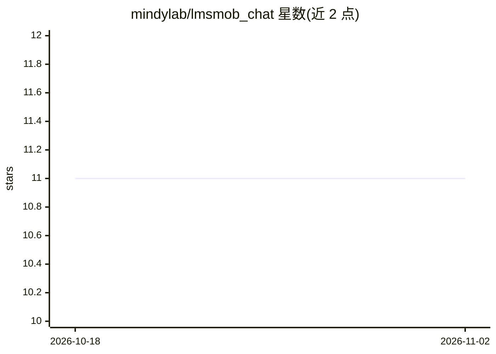

# mindylab/lmsmob_chat

⭐ 11 · Kotlin · NOASSERTION · 推送 2026-09-06 · [GitHub](https://github.com/mindylab/lmsmob_chat) · [官网](https://github.com/mindylab/lmsmob_chat/releases/latest) · 个人维护

**连接 LM Studio 本地服务器的 Android 聊天客户端**

用 Kotlin 与 Jetpack Compose 构建的 Android 应用：通过局域网连接 PC 上运行的 LM Studio 服务器，经 OpenAI 兼容的 /v1 端点与原生 /api/v1/chat 端点对话，支持 MCP/server tools、图片附件、语音输入与 Supertonic 本地 TTS 朗读、本地聊天历史（文件夹/搜索/JSON 导入导出）、通知监控与定时 prompt 的 Watch Jobs。面向在自有电脑上运行本地模型的用户，聊天记录存于设备端。README 顶部声明开发已迁移至 MindyLink，本仓库不再维护。

## 筛选速览

| 维度 | 判定 | 备注 |
|---|---|---|
| AI 角色 | `ai-ecosystem` | LLM/agent 周边工具 |
| 许可风险 | `none` | NOASSERTION |
| 部署形态 | `desktop` | 安装包/桌面程序 |
| 模型依赖 | — | README 未给出锁定关系 |
| 硬件要求 | — | 无带数字的原话,不猜 |
| 安装摩擦 | `low` | 无编译、无系统依赖或容器化 |
| 成熟度 | — | 结构信号不足 |

## 能力要点

- 连接 LM Studio OpenAI 兼容服务器与原生 /api/v1/chat 端点
- 支持 MCP/server tools 及 MCP 图片输出展示
- 本地聊天历史（文件夹、搜索、JSON 导入导出）与文本预设
- Supertonic 本地 TTS 朗读、语音输入、定时 prompt 的 Watch Jobs

## 适用场景

- 在手机上与 PC 上 LM Studio 运行的本地模型对话
- 通过 MCP 工具在聊天中调用网页搜索、截图、二维码等能力
- 定时检查 LM Studio 并按通知触发 AI 分类任务

## 场景标签

`聊天机器人` · 领域:对话与助手

## 证据(README 行号)

> L19: Android chat app for LM Studio. Connect your phone to an LM Studio server
> L42: - Works with LM Studio's OpenAI-compatible local server at `/v1`.

## 星数曲线

2026-10-18 11 → 2026-11-02 11（+0）

---
*卡片 v1 · prompt 1.4 · 生成 2026-11-02 · 置信度 high · 依据 README sha `5c30d2c904fd` · [字段定义](../../DATASET.md)*
