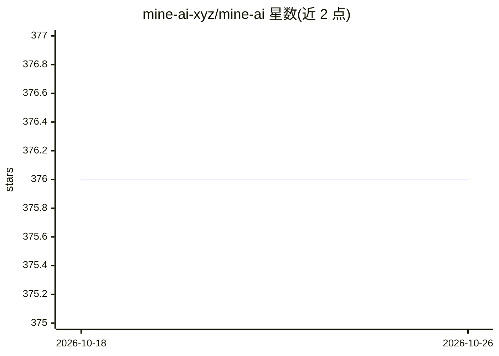

# mine-ai-xyz/mine-ai

⭐ 376 · Python · MIT · 推送 2026-05-13 · [GitHub](https://github.com/mine-ai-xyz/mine-ai) · 组织维护

**支付安全/反欺诈/AML合规的AI参考实现工具包**

开源工具包与命令行工作区，面向美国可及的数字资产与区块链支付系统的支付安全、欺诈检测和 AML/CFT 合规研究。含三个可独立使用的模块：图时序深度学习欺诈检测模型（CNN-LSTM、CSSA、FinSCRA，附论文 DOI）、生产级对账与风险控制参考模式库、基于 RAG 的 LLM 合规推理工作台（检索 BSA/FinCEN/OFAC 等公开语料并输出带引用的可追溯推理）。模型无关，需自带 OpenAI 兼容端点；明确声明为研究与参考实现基础设施，非生产级合规产品。

## 筛选速览

| 维度 | 判定 | 备注 |
|---|---|---|
| AI 角色 | `ai-ecosystem` | LLM/agent 周边工具 |
| 许可风险 | `permissive` | MIT |
| 部署形态 | `library` | 以包/库形式分发 |
| 模型依赖 | — | README 未给出锁定关系 |
| 硬件要求 | — | 无带数字的原话,不猜 |
| 安装摩擦 | `low` | 无编译、无系统依赖或容器化 |
| 成熟度 | `idea` | |

## 能力要点

- 三种图时序欺诈检测架构的参考实现（附论文 DOI）
- RAG 合规推理：可查看推理轨迹、输出引用可追溯
- 模型无关设计，接入任意 OpenAI 兼容端点
- 覆盖链上/链下对账、预言机操纵防御等运营风险模式库

## 适用场景

- 研究区块链支付欺诈检测的图时序模型
- 对 BSA/OFAC 等合规语料做带引用的问答研究
- 参考链上/链下对账与风险控制的工程模式

## 场景标签

`RAG` `网络安全` · 领域:知识与检索

## 证据(README 行号)

> L17: Mine AI is an open-source toolkit and command-line workspace for advancing AI-enabled payment-security, fraud-detec
> L21: This is **research and reference-implementation infrastructure**, not a production fraud-detection product and not 
> L52: Reference implementations of three published or peer-citable architectures for payment-fraud and AML/CFT detection 

## 星数曲线

2026-10-18 376 → 2026-10-26 376（+0）

---
*卡片 v1 · prompt 1.4 · 生成 2026-10-21 · 置信度 mid · 依据 README sha `c836c7cde89c` · [字段定义](../../DATASET.md)*
