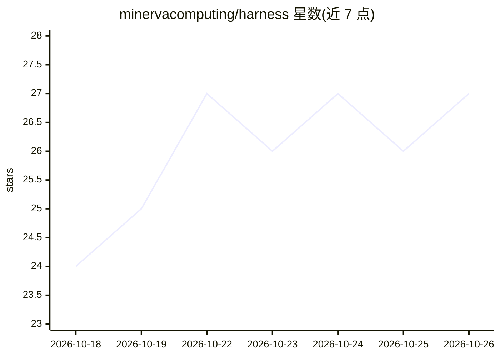

# minervacomputing/harness

⭐ 27 · TypeScript · MIT · 推送 2026-10-25 · [GitHub](https://github.com/minervacomputing/harness) · [官网](https://minervacomputing.com) · 个人维护

**面向敏感数据与关键业务的受控 AI agent 运行引擎**

Minerva 的开源 harness：在 Cloudflare 上运行 agent 回合的引擎，含沙箱、权限检查与连接器。Agent 不持有凭证，命令在无密钥、无网络的封闭 microVM 中执行，每个调用先经按资源粒度（文件夹/标签/频道/金额等）的权限检查。提供 20 个连接器（Gmail、Slack、Stripe、GitHub 等）。产品侧为私有 Laravel 应用，自托管不被支持；需 Node 24 与 pnpm 10，可离线开发运行，账号仅限邀请。

## 筛选速览

| 维度 | 判定 | 备注 |
|---|---|---|
| AI 角色 | `ai-ecosystem` | LLM/agent 周边工具 |
| 许可风险 | `permissive` | MIT |
| 部署形态 | `library` | 以包/库形式分发 |
| 模型依赖 | — | README 未给出锁定关系 |
| 硬件要求 | — | 无带数字的原话,不猜 |
| 安装摩擦 | `low` | 无编译、无系统依赖或容器化 |
| 成熟度 | `idea` | |

## 能力要点

- Agent 不持有凭证，命令运行在无网络无密钥的封闭 microVM
- 每次工具调用前经按资源粒度的权限检查，deny 优先
- 20 个连接器，覆盖邮件、文件、消息、工程、财务等
- 每段对话有独立文件夹，可在 microVM 内执行 shell 与 Python 处理附件

## 适用场景

- 让客服类 agent 在限定权限内执行退款、回复邮件等操作
- 在敏感业务系统（Stripe/Gmail/Slack）上约束 agent 的每一步动作
- 在对话沙箱中让 agent 用命令行和 Python 处理我上传的文件

## 场景标签

`Agent 框架` · 领域:Agent 开发

## 证据(README 行号)

> L11: This repository is **Minerva's open harness**: the engine that runs each agent turn, with its sandbox, its permissi
> L65: The engine is TypeScript on Cloudflare (Workers, Durable Objects, Containers and Dynamic Workers) around pi's durab

## 星数曲线

2026-10-18 24 → 2026-10-26 27（+3）

---
*卡片 v1 · prompt 1.4 · 生成 2026-10-26 · 置信度 mid · 依据 README sha `14d31649bb4e` · [字段定义](../../DATASET.md)*
