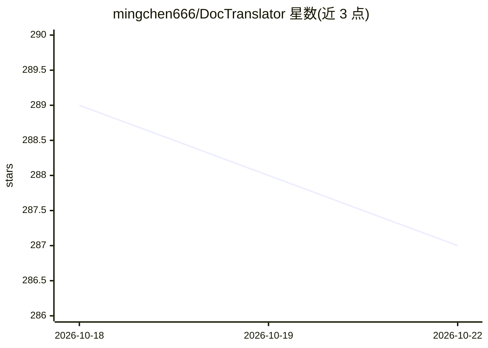

# mingchen666/DocTranslator

⭐ 287 · Python · 推送 2026-09-30 · [GitHub](https://github.com/mingchen666/DocTranslator) · [官网](https://www.doctranslator.cn) · 个人维护 · 中文 README

**面向个人与团队的文档 AI 翻译 Web 应用，支持批量与多线程**

DocTranslator 是基于 Vue 3 + Flask + MySQL/SQLite 的文档翻译 Web 应用，面向个人用户与企业团队。通过兼容 OpenAI 格式的 API 端点接入大模型，对 txt、markdown、word、csv、excel、pdf（非扫描版）、ppt 等格式做 AI 翻译，支持批量上传与多线程处理。提供 Docker/deploy.sh 一键部署、Docker Compose、独立容器与本地开发（pip + pnpm）多种方式；队列可选数据库或 Celery+Redis，翻译结果可存本地或阿里云 OSS。README 顶部宣传收费的 Pro 版本（含术语库、翻译记忆库等）。基于 ezwork 重构，Apache-2.0 许可。

## 筛选速览

| 维度 | 判定 | 备注 |
|---|---|---|
| AI 角色 | `ai-native` | 本体是模型或模型工具 |
| 许可风险 | `none` | — |
| 部署形态 | `self-host` | docker 或自建部署 |
| 模型依赖 | — | README 未给出锁定关系 |
| 硬件要求 | — | 无带数字的原话,不猜 |
| 安装摩擦 | `low` | 无编译、无系统依赖或容器化 |
| 成熟度 | — | 结构信号不足 |

## 能力要点

- 支持 txt/markdown/word/csv/excel/pdf(非扫描版)/ppt 多种文档格式 AI 翻译
- 兼容任意 OpenAI 格式端点 API（中转 API）
- 批量上传与多线程翻译
- Docker/deploy.sh 一键部署，队列可选数据库或 Celery+Redis

## 适用场景

- 批量翻译办公文档并保持原有格式
- 团队自部署文档翻译服务，通过管理端管理
- 接入自有或中转 OpenAI 格式 API 完成翻译任务

## 场景标签

 · 领域:文档翻译/AI 应用

## 证据(README 行号)

> L17: **DocTranslator** 文档翻译，支持多种文件格式的翻译，兼容 OpenAI 格式的 API，并支持批量操作和多线程处理。无论是个人用户还是企业团队，DocTranslator 都能帮助你高效完成文档翻译任务！✨
> L31:  📑 **txt**、📝 **markdown**、📄 **word**、📊 **csv**、📈 **excel**、📑 **pdf(非扫描版)**、📽️ **ppt** 文档的 AI 翻译。
> L49: - **AI 翻译**：兼容 OpenAI 格式

## 星数曲线

2026-10-18 289 → 2026-10-22 287（-2）

---
*卡片 v1 · prompt 1.4 · 生成 2026-10-22 · 置信度 mid · 依据 README sha `69d5ad348c57` · [字段定义](../../DATASET.md)*
