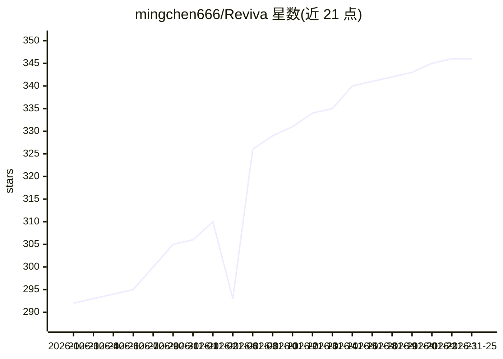

# mingchen666/Reviva

⭐ 346 · Python · 推送 2026-11-23 · [GitHub](https://github.com/mingchen666/Reviva) · [官网](https://www.reviva.cn) · 个人维护 · 中文 README

**本地优先的 AI 学习工作台：围绕个人资料问答、笔记、复习与创作**

面向学习与知识工作的本地桌面 Agent 应用，将对话、文档、Wiki 知识库、笔记、复习与创作工具放在同一工作区。数据主要保存在本地工作目录与 SQLite；Agent 可调用 Skills、文件工具、Office 操作、知识库检索与 MCP，输出测验、闪卡、导图、PPT、研究报告等产物，其中 13 个创作工具中 12 个本地生成、播客走云端。支持多 Agent 共享上下文与全局记忆。当前正式版本 1.5.2，主要面向 Windows 和 macOS；AGPL-3.0 开源，商用需商业授权。

## 筛选速览

| 维度 | 判定 | 备注 |
|---|---|---|
| AI 角色 | `ai-native` | 本体是模型或模型工具 |
| 许可风险 | `dual` | — |
| 部署形态 | `None` |  |
| 模型依赖 | local-ok | 支持本地模型 |
| 硬件要求 | — | 无带数字的原话,不猜 |
| 安装摩擦 | `medium` | 含编译或系统依赖之一 |
| 成熟度 | — | 结构信号不足 |

## 能力要点

- 内置 18 个学习向 Agent 与 61 个 Skill，支持自定义创建与导入
- 13 个创作工具生成测验、闪卡、导图、知识图谱、PPT、研究报告等，12 个可本地生成
- 内置 KBP 协议接入 Dify/FastGPT/MCP/自定义 HTTP 外部知识库，对话时自动检索
- 对话、语音（ASR）、图像生成编辑与 OCR 四类模型可分别配置，含本地 Ollama

## 适用场景

- 按课程建立 Wiki 知识库，复习时生成测验、闪卡与错题回顾
- 导入课程录屏，转录后针对某段内容向 Agent 提问
- 持续沉淀阅读与工作资料，构建个人第二大脑
- 知识工作者围绕项目资料与 Office 文档完成分析与汇报

## 场景标签

`知识库管理` `RAG` `文档问答` `多智能体` · 领域:Agent 开发

## 证据(README 行号)

> L47: Reviva 是一个面向学习、研究和知识工作的本地桌面 Agent。它把对话、文档、知识库、笔记、复习工具和创作输出放在同一个工作台里。
> L51: Reviva = 本地资料库 + Wiki 知识库 + AI Agent + 知识库检索 + 笔记文档管理 + Skills 能力系统 + 创作工具。
> L311: - 对话、文档、笔记、知识库、Agent 配置和任务记录主要保存在本地工作目录及 SQLite 数据库中。

## 星数曲线

2026-10-23 292 → 2026-11-25 346（+54）

---
*卡片 v1 · prompt 1.4 · 生成 2026-11-25 · 置信度 high · 依据 README sha `52046193c0b4` · [字段定义](../../DATASET.md)*
