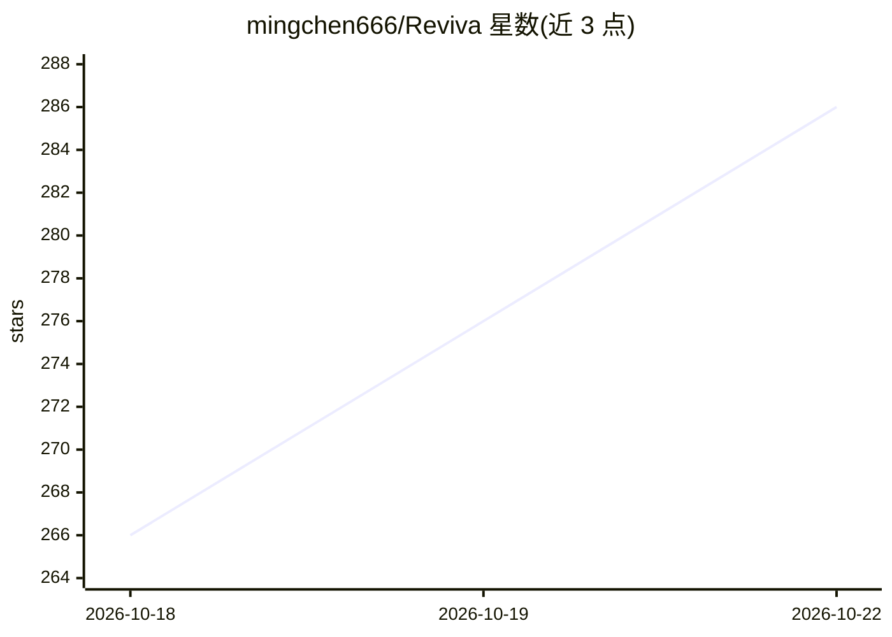

# mingchen666/Reviva

⭐ 286 · HTML · 推送 2026-10-17 · [GitHub](https://github.com/mingchen666/Reviva) · [官网](https://www.reviva.cn) · 个人维护 · 中文 README

**本地优先的 AI 学习工作台：围绕自有资料问答、笔记、复习与创作**

桌面端 AI 学习工作台，面向学生、备考者、知识工作者与个人知识管理用户。以 Agent 为核心，提供对话、文档导入解析（Office/PDF/Markdown/音视频）、Wiki 知识库沉淀、Markdown 笔记、语音转录与关键帧提取，以及测验、闪卡、思维导图、PPT、播客等 13 个创作工具（其中 12 个可本地生成）。支持多 Agent 切换共享上下文、61 个内置 Skill、KBP 协议接入 Dify/FastGPT/MCP 知识库。模型接入自有 API Key、OpenAI-compatible、Anthropic 协议或本地 Ollama。本地优先，数据存本地与 SQLite。AGPL-3.0 + 商业双授权，商用需获授权。提供 Windows/macOS 安装包，当前版本 1.4.2。

## 筛选速览

| 维度 | 判定 | 备注 |
|---|---|---|
| AI 角色 | `ai-native` | 本体是模型或模型工具 |
| 许可风险 | `dual` | — |
| 部署形态 | `None` |  |
| 模型依赖 | local-ok | 支持本地模型 |
| 硬件要求 | — | 无带数字的原话,不猜 |
| 安装摩擦 | `medium` | 含编译或系统依赖之一 |
| 成熟度 | `idea` | |

## 能力要点

- 18 个内置学习向 Agent，61 个内置 Skill，支持自定义 Agent/Skill
- 13 个创作工具：测验、闪卡、思维导图、知识图谱、PPT、播客等
- KBP 协议接入 Dify/FastGPT/MCP/自定义 HTTP 外部知识库
- 音视频解析：语音转录与关键帧提取，围绕媒体内容问答

## 适用场景

- 期末复习：导入课件历年题，生成测验、闪卡与错题回顾
- 课程录屏学习：转录视频、提取关键帧后针对内容提问
- 把学习与工作资料沉淀为 Wiki，构建个人第二大脑
- 围绕项目文档与会议记录完成分析、汇报与知识沉淀

## 场景标签

`知识库管理` `文档问答` `AI 助手` · 领域:对话与助手

## 证据(README 行号)

> L40: Reviva 是一个面向学习、研究和知识工作的本地桌面 Agent。它把对话、文档、知识库、笔记、复习工具和创作输出放在同一个工作台里。
> L44: Reviva = 本地资料库 + Wiki 知识库 + AI Agent + 知识库检索 + 笔记文档管理 + Skills 能力系统 + 创作工具。
> L101: - 🎓 **学生与备考者**：整理课程资料、讲义和错题，生成测验、闪卡、导图与复习内容。

## 星数曲线

2026-10-18 266 → 2026-10-22 286（+20）

---
*卡片 v1 · prompt 1.4 · 生成 2026-10-22 · 置信度 high · 依据 README sha `6045a43caded` · [字段定义](../../DATASET.md)*
