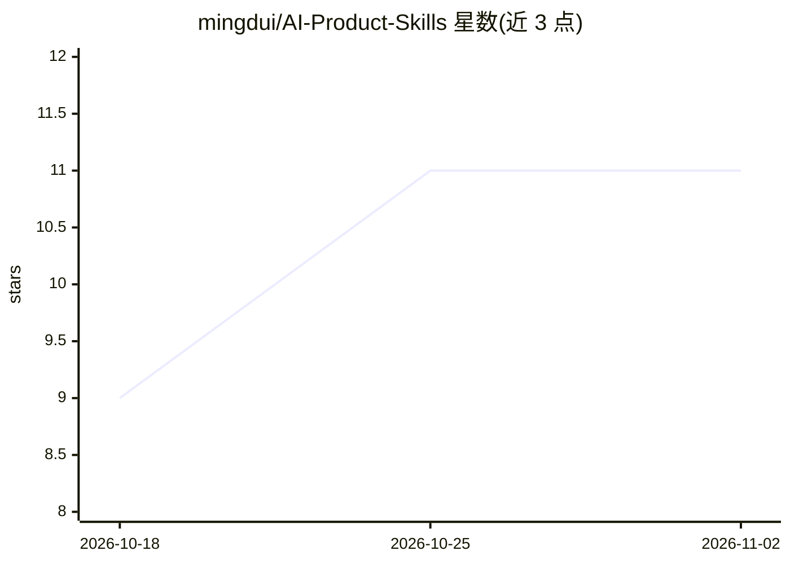

# mingdui/AI-Product-Skills

⭐ 11 · JavaScript · NOASSERTION · 推送 2026-10-13 · [GitHub](https://github.com/mingdui/AI-Product-Skills) · 个人维护 · 中文 README

**面向产品经理的 11 个 agent skill：需求→PRD→可交互原型**

一组可安装到 Claude Code 等 agent 环境的产品经理工作流 skill（共 11 个），覆盖口头需求澄清、Word 需求转结构化 PRD、PRD 压测、从竞品站/截图提取设计规范、生成可点击的高保真 HTML 原型、上线前验收清单等环节。各 skill 产物落在同一目录（docs/prd/<feature-name>/），下一环节直接读取上一环节产物。提供插件市场、npx skills、手动拷贝三种安装方式；仅 product-prd-extract 需要 Node ≥ 20。不替代 Figma/Axure，不做自动化测试。

## 筛选速览

| 维度 | 判定 | 备注 |
|---|---|---|
| AI 角色 | `ai-ecosystem` | LLM/agent 周边工具 |
| 许可风险 | `none` | NOASSERTION |
| 部署形态 | `library` | 以包/库形式分发 |
| 模型依赖 | — | README 未给出锁定关系 |
| 硬件要求 | — | 无带数字的原话,不猜 |
| 安装摩擦 | `low` | 无编译、无系统依赖或容器化 |
| 成熟度 | — | 结构信号不足 |

## 能力要点

- 11 个 skill 覆盖需求澄清→PRD→原型→验收全链路
- 产物统一落盘，环节间自动衔接无需手工搬运
- web-design-extractor 区分 [OBSERVED]/[INFERRED]/[UNKNOWN] 提取设计规范
- 支持接入已有前端项目复用真实组件（pm-frontend-prototype）

## 适用场景

- 把口头需求或 Word 需求转成开发可用的结构化 PRD
- 用竞品站或截图做设计依据生成可点击的高保真原型
- 研发提测后逐条走查并指回 PRD 需求编号

## 场景标签

`提示工程` · 领域:Agent 开发

## 证据(README 行号)

> L3: 面向产品经理的 AI 工作流：11 个 skill，把需求写成完整 PRD，再做成高保真可交互原型。
> L104: **Claude Code 插件市场**

## 星数曲线

2026-10-18 9 → 2026-11-02 11（+2）

---
*卡片 v1 · prompt 1.4 · 生成 2026-11-02 · 置信度 high · 依据 README sha `d10c9ca8cd30` · [字段定义](../../DATASET.md)*
