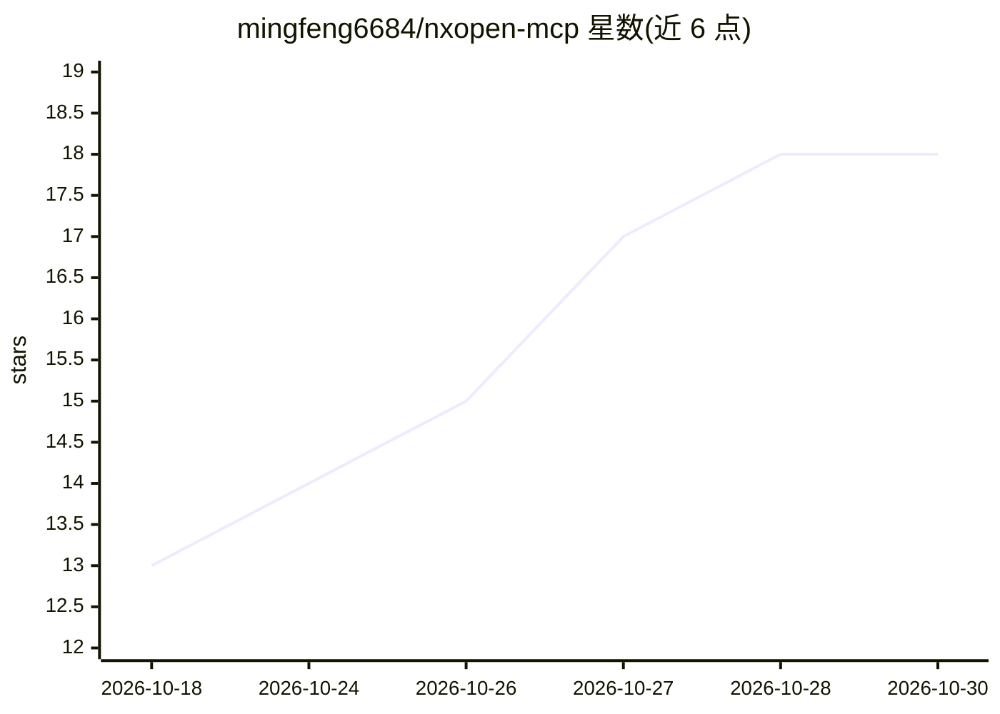

# mingfeng6684/nxopen-mcp

⭐ 18 · Python · MIT · 推送 2026-07-15 · [GitHub](https://github.com/mingfeng6684/nxopen-mcp) · 个人维护 · 中文 README

**为 AI 编码 agent 提供 NXOpen .NET API 知识检索的 MCP server**

面向 Claude Code、Codex、Cursor 等 AI 编码 agent 的 MCP server：从用户自有授权的 Siemens NX 安装中读取 NXOpen*.xml 文档与 DLL，构建本地 SQLite 索引（BGE-M3 稠密向量 + 精确名称双通道，RRF 可选融合），提供 search_api、get_class、get_member、find_builder 四个工具，以检索结果约束 agent 的 API 调用。全流程本地离线运行，不携带 Siemens 文件。需 Python 3.11+，首次语义查询加载约 2GB 模型耗时 1-2 分钟，全量索引构建需数小时。

## 筛选速览

| 维度 | 判定 | 备注 |
|---|---|---|
| AI 角色 | `ai-ecosystem` | LLM/agent 周边工具 |
| 许可风险 | `permissive` | MIT |
| 部署形态 | `desktop` | 安装包/桌面程序 |
| 模型依赖 | — | README 未给出锁定关系 |
| 硬件要求 | — | 无带数字的原话,不猜 |
| 安装摩擦 | `medium` | 含编译或系统依赖之一 |
| 成熟度 | — | 结构信号不足 |

## 能力要点

- BGE-M3 稠密 + 精确名称双通道混合检索，支持中英文查询
- 以单个 API 成员为索引单元，检索结果与可操作实体一一对应
- pythonnet 反射提取继承链，未安装时优雅降级
- 预建索引以单一 SQLite 文件（约 500MB）在团队内共享

## 适用场景

- 让 AI 编码 agent 写 NXOpen 自动化代码时引用真实存在的 API
- CAM 操作开发中通过 find_builder 获取 Builder→Commit→Destroy 代码骨架
- 查询某 API 成员的签名、NX 版本与许可证要求

## 场景标签

`语义搜索` · 领域:知识与检索

## 证据(README 行号)

> L5: MCP server that gives AI coding agents (Claude Code, Codex, Cursor)
> L25: Everything runs locally and offline against an index built from your own
> L128: |`search_api`|Hybrid semantic search over the API (dense + exact-name by default, sparse optional). Accepts Englis

## 星数曲线

2026-10-18 13 → 2026-10-30 18（+5）

---
*卡片 v1 · prompt 1.4 · 生成 2026-10-29 · 置信度 high · 依据 README sha `1b4f9cb82734` · [字段定义](../../DATASET.md)*
