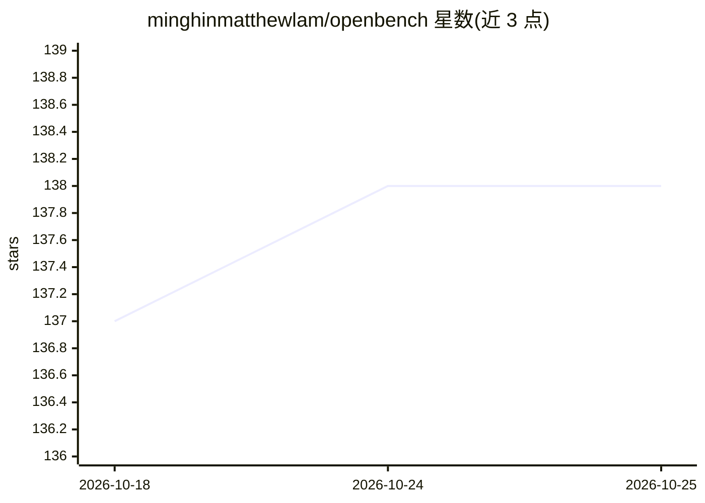

# minghinmatthewlam/openbench

⭐ 138 · Python · MIT · 推送 2026-08-27 · [GitHub](https://github.com/minghinmatthewlam/openbench) · 个人维护

**对比 coding-agent harness 性能的评测基准框架**

从零构建的基准框架：固定底层模型与任务，横向对比 codex、pi、opencode、cursor、devin 等 coding-agent harness 在正确率、耗时与 token 成本上的差异。任务由独立 checker 脚本评分（exit 0 即解决，支持 SCORE: 部分分），任务工作区复制到临时目录隔离执行。另含 Gateway Bench（固定 harness 比较网关）与 Router Bench 设计草案。核心 runner 仅用 Python 标准库，通过 pip 安装 obench CLI；无需 GPU，真实 harness 运行需对应 CLI 与登录/API key，公开模型面板复现成本约 $1。

## 筛选速览

| 维度 | 判定 | 备注 |
|---|---|---|
| AI 角色 | `ai-ecosystem` | LLM/agent 周边工具 |
| 许可风险 | `permissive` | MIT |
| 部署形态 | `self-host` | docker 或自建部署 |
| 模型依赖 | — | README 未给出锁定关系 |
| 硬件要求 | — | 无带数字的原话,不猜 |
| 安装摩擦 | `low` | 无编译、无系统依赖或容器化 |
| 成熟度 | — | 结构信号不足 |

## 能力要点

- Track A：同一模型下变换 harness，差异归因于脚手架/工具/权限
- checker 脚本独立评分，支持 SCORE: 部分分契约
- 开放模型面板（glm/deepseek/kimi）经适配器直连或本地桥接运行
- 核心 runner 仅依赖 Python 3 标准库，无第三方 Python 依赖

## 适用场景

- 选型前比较不同 coding-agent CLI 的正确率与 token 成本
- 约 $1 成本复现开源模型基准矩阵
- 在私有代码库上对 harness 做内部评测

## 场景标签

`模型评测` · 领域:评测与运维

## 证据(README 行号)

> L6: A benchmark for comparing coding-agent **harnesses** — the CLI tools that wrap a
> L47: OpenBench has two separate benchmark families. **Harness Bench**, described

## 星数曲线

2026-10-18 137 → 2026-10-25 138（+1）

---
*卡片 v1 · prompt 1.4 · 生成 2026-10-23 · 置信度 mid · 依据 README sha `a81649c21fda` · [字段定义](../../DATASET.md)*
