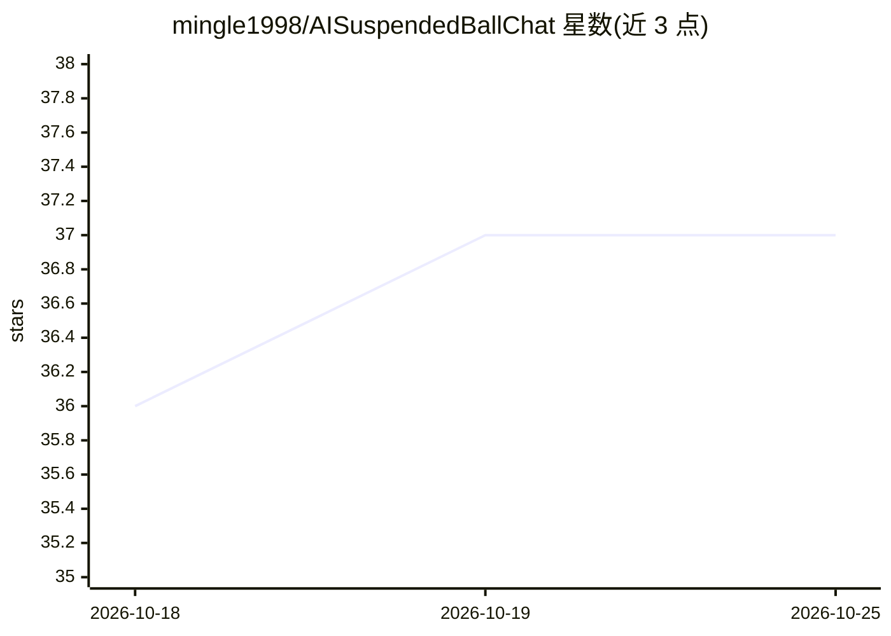

# mingle1998/AISuspendedBallChat

⭐ 37 · Apache-2.0 · 推送 2026-06-15 · [GitHub](https://github.com/mingle1998/AISuspendedBallChat) · [官网](https://www.npmjs.com/package/ai-suspended-ball-chat) · 个人维护 · 中文 README

**Vue3 应用的 AI 聊天悬浮球/面板前端组件**

面向 Vue3 应用的 AI 聊天前端组件，提供悬浮球（SuspendedBallChat）与独立面板（ChatPanel）两种形态。功能含流式 SSE、普通请求、WebSocket 三种请求模式，图片上传、语音输入与语音播报、本地历史记录、上下文记忆、白天/夜间主题、ECharts 图表渲染，并支持在 Markdown 对话流中通过占位符动态渲染卡片/轮播/二维码/表单等自定义组件，业务层通过全局事件接收交互结果。后端接口可自定义，需按文档约定返回 JSON/SSE 格式。仅限 Vue3，其他技术栈需改用 ai-chat-embed 版本。

## 筛选速览

| 维度 | 判定 | 备注 |
|---|---|---|
| AI 角色 | `ai-ecosystem` | LLM/agent 周边工具 |
| 许可风险 | `permissive` | Apache-2.0 |
| 部署形态 | `library` | 以包/库形式分发 |
| 模型依赖 | — | README 未给出锁定关系 |
| 硬件要求 | — | 无带数字的原话,不猜 |
| 安装摩擦 | `low` | 无编译、无系统依赖或容器化 |
| 成熟度 | — | 结构信号不足 |

## 能力要点

- SuspendedBallChat 悬浮球与 ChatPanel 独立面板两种形态
- 普通请求/流式 SSE/WebSocket 三种请求模式，后端接口可自定义
- Markdown 对话流中占位符动态渲染卡片、轮播、二维码、表单等组件
- 图片上传、语音输入、语音播报、本地历史记录与上下文记忆

## 适用场景

- 给自己的网站/应用快速接入一个悬浮 AI 助手
- 通过自定义组件在对话流中展示卡片、图表、表单等富内容
- 需要历史记录与工单搜集的客服式 AI 面板

## 场景标签

`AI 助手` `聊天机器人` · 领域:对话与助手

## 证据(README 行号)

> L3: 一个功能强大的AI聊天Vue3组件，支持流式响应、图片上传、语音播报、历史记录管理等功能。该AI组件可以作为悬浮球或独立面板使用。
> L17: - 🤖 **AI对话**: 支持与AI进行自然语言对话
> L18: - 📡 **多模式请求**: 支持普通请求和流式(SSE)响应、WebSocket三种模式

## 星数曲线

2026-10-18 36 → 2026-10-25 37（+1）

---
*卡片 v1 · prompt 1.4 · 生成 2026-10-25 · 置信度 high · 依据 README sha `2ec0af8753b4` · [字段定义](../../DATASET.md)*
