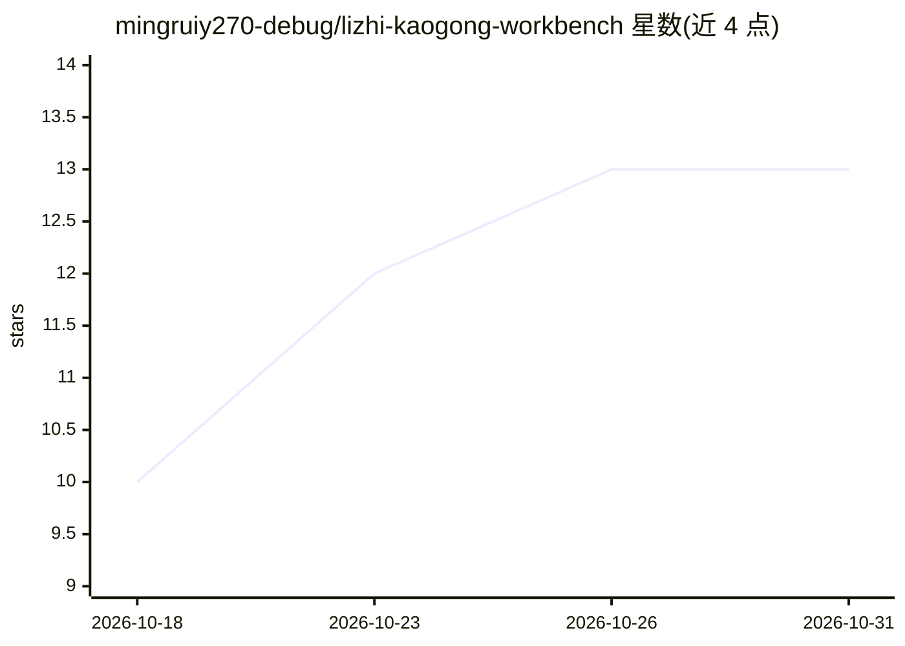

# mingruiy270-debug/lizhi-kaogong-workbench

⭐ 13 · TypeScript · MIT · 推送 2026-08-18 · [GitHub](https://github.com/mingruiy270-debug/lizhi-kaogong-workbench) · 个人维护 · 中文 README

**本地优先的公考学习工作台，可选接入云端或本地 AI**

面向公务员考试备考者的 Electron 桌面应用：集中管理 Markdown 题库与知识文档、错题、笔记、模考和学习计划，覆盖行测训练、申论训练、学习分析与模拟考试。基础学习功能可离线运行；AI 为可选配置，可连接用户自选的云端模型或 Ollama、LM Studio 等本地模型，用于错题讲解、申论语义评估、变式题生成等。知识库工坊通过 MarkItDown 本地转换 PDF/Word 等格式，LLM 整理结果须经人工批准才发布。API Key 用 Electron safeStorage 加密保存。Windows x64 提供安装包，源码运行需 Node.js 24 与 Windows 环境，知识库工坊另需 Python 3.10+。

## 筛选速览

| 维度 | 判定 | 备注 |
|---|---|---|
| AI 角色 | `ai-enhanced` | 去掉 AI 部分产品仍成立 |
| 许可风险 | `permissive` | MIT |
| 部署形态 | `None` |  |
| 模型依赖 | — | README 未给出锁定关系 |
| 硬件要求 | — | 无带数字的原话,不猜 |
| 安装摩擦 | `low` | 无编译、无系统依赖或容器化 |
| 成熟度 | — | 结构信号不足 |

## 能力要点

- 多知识库管理：Markdown 导入、增量索引、全文搜索、快照回滚
- 知识库工坊：MarkItDown 本地转换 15 种格式 + LLM 整理 + 人工审核发布
- AI 可选：云端模型或 Ollama/LM Studio 本地模型，基础功能离线可用
- 数据本地保存，API Key 经 safeStorage 加密，AI 生成内容不自动入库

## 适用场景

- 集中管理公考题库、错题与笔记并做模考训练
- 把自己的 Markdown/Word/PDF 资料整理成可训练的知识库
- 离线刷题，需要时再接入本地或云端模型做讲解与评估

## 场景标签

`知识库管理` · 领域:知识与检索

## 证据(README 行号)

> L7: 一个开源、本地优先、支持自定义知识库与可选 AI 的私人公考学习工作台。
> L9: 砺知考公工作台用于集中管理题库、知识文档、错题、笔记、模考和学习计划。基础学习功能可以离线运行；需要 AI 时，可以连接自己选择的云端模型，也可以使用 Ollama、LM Studio 等本地模型。
> L51: API Key 使用 Electron `safeStorage` 加密保存，不写入 `.env`、Markdown 知识库或页面日志。清除凭据后，基础训练功能仍可继续使用。

## 星数曲线

2026-10-18 10 → 2026-10-31 13（+3）

---
*卡片 v1 · prompt 1.4 · 生成 2026-10-31 · 置信度 high · 依据 README sha `5c56cf9bf7d1` · [字段定义](../../DATASET.md)*
