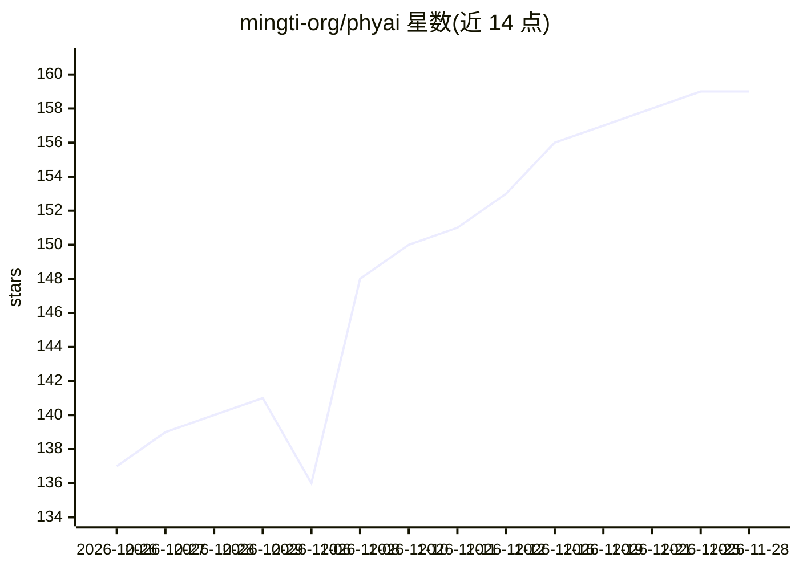

# mingti-org/phyai

⭐ 159 · Python · MIT · 推送 2026-11-17 · [GitHub](https://github.com/mingti-org/phyai) · [官网](https://phyai.mintlify.app/) · 组织维护 · 中文 README

**Physical AI 模型（VLA/WAM）的低延迟推理服务引擎**

面向 Physical AI 的推理服务引擎，优先保证时延敏感负载（策略/动作模型）的运行。支持 VLA、WAM 与基础模型列表（如 π0/π0.5、GR00T N1.7、Cosmos3 系列），可在 NVIDIA Jetson 边缘设备运行，也可通过 DP/TP/CFG 并行扩展到 GPU 集群；内置 phyai-gateway 支持多主机服务，加载未量化 checkpoint 时可经 kernel policy YAML 做 PTQ 量化（INT4/INT8/FP8/MXFP4/NVFP4）。从源码或 nightly 包安装，MIT 许可。

## 筛选速览

| 维度 | 判定 | 备注 |
|---|---|---|
| AI 角色 | `ai-ecosystem` | LLM/agent 周边工具 |
| 许可风险 | `permissive` | MIT |
| 部署形态 | `library` | 以包/库形式分发 |
| 模型依赖 | — | README 未给出锁定关系 |
| 硬件要求 | — | 无带数字的原话,不猜 |
| 安装摩擦 | `low` | 无编译、无系统依赖或容器化 |
| 成熟度 | — | 结构信号不足 |

## 能力要点

- 支持 VLA/WAM/基础模型三类模型的服务（π0/π0.5、GR00T N1.7、Cosmos3 等）
- 可在 NVIDIA Jetson 边缘设备运行，也支持 DP/TP/CFG 并行扩展
- kernel policy YAML 控制 PTQ 量化（INT4/INT8/FP8/MXFP4/NVFP4）
- phyai-gateway 多主机服务，客户端走 HTTP 或 gRPC

## 适用场景

- 为机器人策略模型部署低延迟推理服务
- 在 Jetson 边缘设备上部署 VLA 模型
- 用 gateway 把多台模型主机组成服务集群
- 对未量化 checkpoint 做推理时后训练量化

## 场景标签

`推理引擎` `模型量化` · 领域:训练与推理

## 证据(README 行号)

> L10: **PhyAI** (pronounced "phi") is a **latency-first serving engine for Physical AI**.
> L38: - 🚀 Runs on NVIDIA Jetson edge devices
> L126: You can run model servers on separate machines and connect them through

## 星数曲线

2026-10-26 137 → 2026-11-28 159（+22）

---
*卡片 v1 · prompt 1.4 · 生成 2026-11-28 · 置信度 high · 依据 README sha `7cc0b0314566` · [字段定义](../../DATASET.md)*
