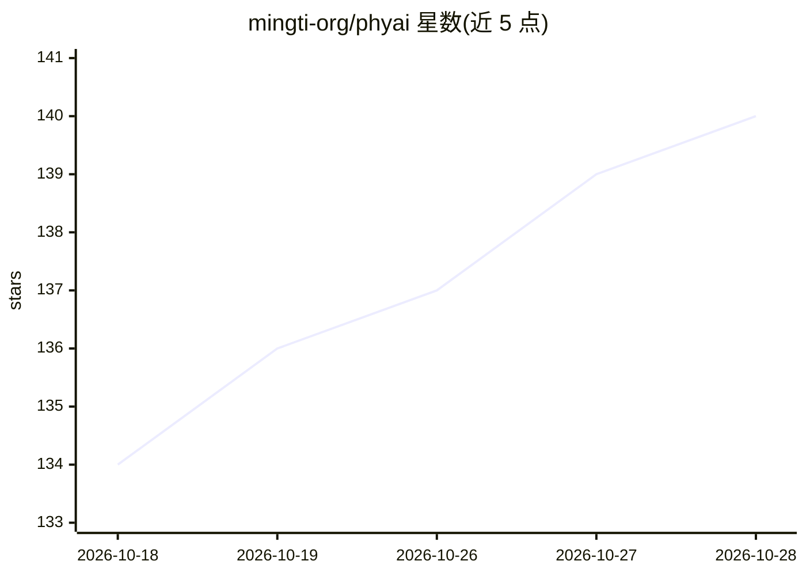

# mingti-org/phyai

⭐ 140 · Python · MIT · 推送 2026-10-27 · [GitHub](https://github.com/mingti-org/phyai) · [官网](https://phyai.mintlify.app/) · 组织维护 · 中文 README

**面向 Physical AI 的低延迟推理服务引擎（VLA/WAM 模型）**

PhyAI 是为 Physical AI 模型（VLA、WAM、基础模型）设计的延迟优先服务引擎，面向交互系统中运行的策略与动作模型。支持 NVIDIA Jetson 边缘设备运行与 GPU 集群上的 DP/TP/CFG 并行扩展；支持 π0、π0.5、GR00T N1.7、MiniCPM-Robot、Cosmos3、Qwen 系列等模型。通过 kernel policy YAML 实现 INT4/INT8/FP8/MXFP4/NVFP4 后训练量化（依赖 FlashInfer 与 Humming 内核）；提供 phyai server 与 phyai-gateway 实现多机多副本服务，通过 HTTP/gRPC 对外提供接口。安装方式为源码构建（git clone + uv sync）或 nightly pip 包（自有索引）。MIT 许可。

## 筛选速览

| 维度 | 判定 | 备注 |
|---|---|---|
| AI 角色 | `ai-ecosystem` | LLM/agent 周边工具 |
| 许可风险 | `permissive` | MIT |
| 部署形态 | `library` | 以包/库形式分发 |
| 模型依赖 | — | README 未给出锁定关系 |
| 硬件要求 | — | 无带数字的原话,不猜 |
| 安装摩擦 | `low` | 无编译、无系统依赖或容器化 |
| 成熟度 | — | 结构信号不足 |

## 能力要点

- 支持 NVIDIA Jetson 边缘设备与 GPU 集群（DP/TP/CFG 并行）部署
- kernel policy YAML 控制的多精度量化（INT4/INT8/FP8/MXFP4/NVFP4，W4A16 需 SM80+）
- phyai-gateway 多主机服务与副本负载分发（HTTP/gRPC）
- 支持 π0/π0.5、GR00T N1.7、MiniCPM-Robot、Cosmos3、Qwen 系列等模型

## 适用场景

- 在机器人上部署 VLA 策略模型并做低延迟推理服务
- 多机 GPU 集群上服务多个模型副本并统一网关接入
- 对未量化 checkpoint 做后训练量化以降低部署开销

## 场景标签

`推理引擎` `模型量化` `模型网关` · 领域:Agent 开发

## 证据(README 行号)

> L10: **PhyAI** (pronounced "phi") is a **latency-first serving engine for Physical AI**.
> L33: - 🚀 Scales to GPU clusters with DP, TP, and CFG parallelism
> L181: PhyAI is released under the MIT License. It uses FlashInfer, Humming, and FLA. We have also learned a great deal f

## 星数曲线

2026-10-18 134 → 2026-10-28 140（+6）

---
*卡片 v1 · prompt 1.4 · 生成 2026-10-22 · 置信度 mid · 依据 README sha `d728d21ae8ff` · [字段定义](../../DATASET.md)*
