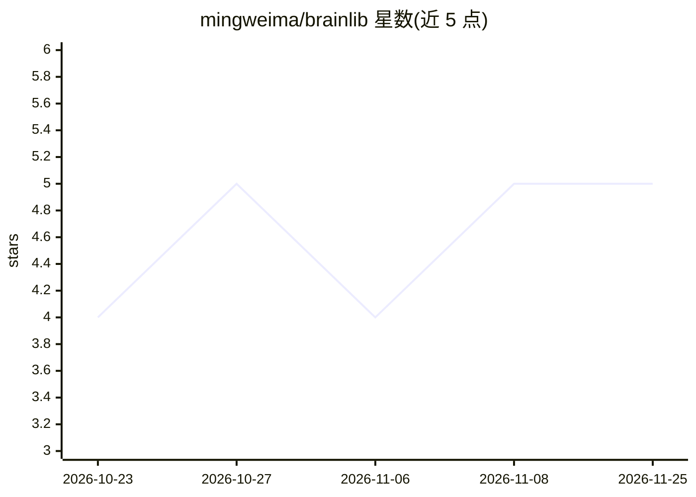

# mingweima/brainlib

⭐ 5 · Python · Apache-2.0 · 推送 2026-10-21 · [GitHub](https://github.com/mingweima/brainlib) · [官网](https://mamingwei.com) · 个人维护 · 中文 README

**给接上本地 AI 助手的用户维护一份共用的大脑库记忆**

一个 agent-agnostic 的 harness 命令行工具：在用户电脑上维护一个 Markdown 大脑库文件夹，接上的各 AI 助手共用同一份。capturer 把用户原话带来源与时间戳记入缓存区，organizer 生成修改建议由用户批准后写入，maintainer 定期做体检归档；笔记按 L0-L3 分层，索引长度固定，支持 age 加密保险箱、MCP 接入、隐私检查与自动更新。五档能力递进，从只读到多助手。需本机运行（Mac/Linux 实际验证过），Python 3.9+。

## 筛选速览

| 维度 | 判定 | 备注 |
|---|---|---|
| AI 角色 | `ai-ecosystem` | LLM/agent 周边工具 |
| 许可风险 | `permissive` | Apache-2.0 |
| 部署形态 | `None` |  |
| 模型依赖 | — | README 未给出锁定关系 |
| 硬件要求 | — | 无带数字的原话,不猜 |
| 安装摩擦 | `low` | 无编译、无系统依赖或容器化 |
| 成熟度 | — | 结构信号不足 |

## 能力要点

- capturer/organizer/maintainer 三模块：缓存、审批式写入、定期体检
- 记录带六种来源标记与分钟级时间戳，支持 --replaces 版本替换与 undo 撤回
- 固定长度 index + next 逐步驱动机制，输出格式固定便于小模型执行
- 隐私机制：私密笔记不返回、敏感信息拒收、age 加密保险箱

## 适用场景

- 让 Cursor、Claude Code、Codex 等工具里的 AI 共享同一份用户偏好与决定
- 换模型或开新对话时不重复交代 context、保留长记忆
- 把已有 Obsidian 等 Markdown 笔记文件夹直接接上供 AI 读写
- 敏感内容用加密保险箱隔离，AI 查找阅读时不返回私密笔记

## 场景标签

`Agent 记忆` `知识库管理` · 领域:Agent 开发

## 证据(README 行号)

> L9: `brainlib` 做的事情就是在你自己电脑上 maintain 一个「大脑库」文件夹，不管用什么本地 AI agent，都可以和它交互，每次和你聊完把新学到的记下来，所以换模型都不会丢失你的所有 agent 记忆（agent-a
> L120: `brainlib` 是一个命令行程序，只用 Python 标准库，不在后台常驻。AI 从命令行调它，它做完一件事就退出；通过 MCP 接的时候，由 AI 工具把它启动起来，工具关了它也就退出了。下图里每个箭头都是 AI 运行的

## 星数曲线

2026-10-23 4 → 2026-11-25 5（+1）

---
*卡片 v1 · prompt 1.4 · 生成 2026-11-21 · 置信度 high · 依据 README sha `691ecd204358` · [字段定义](../../DATASET.md)*
