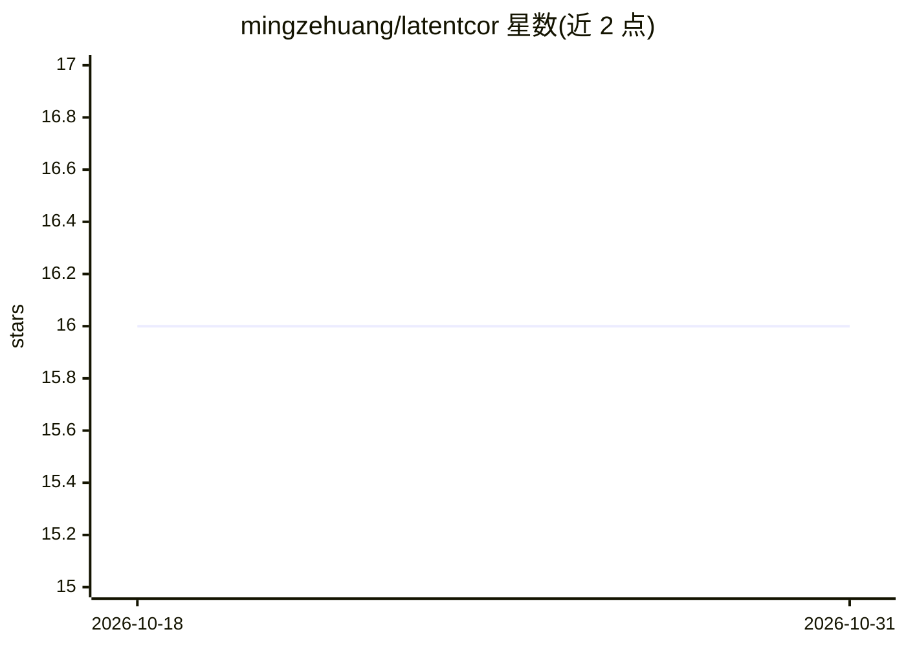

# mingzehuang/latentcor

⭐ 16 · R · GPL-3.0 · 推送 2025-11-18 · [GitHub](https://github.com/mingzehuang/latentcor) · [官网](https://mingzehuang.github.io/latentcor/) · 个人维护

**R 包：混合类型数据（连续/二值/截断/三元）的潜相关系数估计**

latentcor 是一个 R 统计包，在潜高斯联接模型（latent Gaussian copula）框架下估计混合类型变量（连续、二值、截断/零膨胀、三元/有序）之间的潜相关系数，支持原始方法与基于预存格点插值的近似方法，后者计算速度接近基于秩的相关估计。安装途径为 CRAN 稳定版或 devtools 从 GitHub 安装开发版；需先安装 R，可选 RStudio 作为 IDE。限制：近似方法在边界（零比例）附近精度较低；另有 Python 版本可用。

## 筛选速览

| 维度 | 判定 | 备注 |
|---|---|---|
| AI 角色 | `ai-native` | 本体是模型或模型工具 |
| 许可风险 | `viral` | GPL-3.0 |
| 部署形态 | `None` |  |
| 模型依赖 | — | README 未给出锁定关系 |
| 硬件要求 | — | 无带数字的原话,不猜 |
| 安装摩擦 | `low` | 无编译、无系统依赖或容器化 |
| 成熟度 | — | 结构信号不足 |

## 能力要点

- 支持连续/二值/截断/三元四种混合数据类型
- 原始方法与基于多线性插值的近似方法两种计算路径
- CRAN 稳定版与 GitHub 开发版两种安装渠道

## 适用场景

- 对含二值、有序、零膨胀变量的混合数据估计相关矩阵
- 高维混合数据下作为图模型/CCA 分析的前置相关估计
- 用 mtcars 等内置数据示例快速上手与结果可视化

## 场景标签

 · 领域:统计/数据分析

## 证据(README 行号)

> L11: `latentcor` is an `R` package for estimation of latent correlations with mixed data types (continuous, binary, trun
> L23: No R software package is currently available that allows accurate and fast correlation estimation from mixed variab

## 星数曲线

2026-10-18 16 → 2026-10-31 16（+0）

---
*卡片 v1 · prompt 1.4 · 生成 2026-10-30 · 置信度 mid · 依据 README sha `2320aed18ef0` · [字段定义](../../DATASET.md)*
