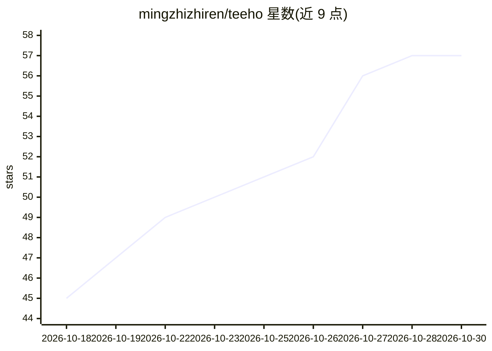

# mingzhizhiren/teeho

⭐ 57 · TypeScript · NOASSERTION · 推送 2026-10-26 · [GitHub](https://github.com/mingzhizhiren/teeho) · [官网](https://teeho.chat) · 个人维护 · 中文 README

**面向小红书创作者的笔记诊断 Agent Skill**

以 Agent Skill 形式分发的小红书笔记诊断工具：用户将笔记标题、正文、话题、封面及图片/视频交给 Agent，题火调用后端服务，基于自研洞察模型与爬取的大盘笔记数据匹配优秀笔记，输出量化评分（中位数/最低/最高分）与优化意见的报告。随附 Python CLI，不绑定单一 Agent 产品；诊断数据发送到题火服务处理，依赖每日免费积分，视频分析需付费套餐。只诊断不代写。仓库采用 PolyForm Noncommercial 许可，源码不含线上私有模型与数据。

## 筛选速览

| 维度 | 判定 | 备注 |
|---|---|---|
| AI 角色 | `ai-native` | 本体是模型或模型工具 |
| 许可风险 | `none` | NOASSERTION |
| 部署形态 | `None` |  |
| 模型依赖 | — | README 未给出锁定关系 |
| 硬件要求 | — | 无带数字的原话,不猜 |
| 安装摩擦 | `low` | 无编译、无系统依赖或容器化 |
| 成熟度 | — | 结构信号不足 |

## 能力要点

- Agent Skill 形式分发，附随 Python CLI，不绑定单一 Agent 产品
- 基于自研洞察模型与大盘笔记数据输出量化评分与优化意见
- 提供源码安装、GitHub Release 包与一句话 Agent 安装三种方式
- 支持自部署指南，可用自有数据与评分规则定制

## 适用场景

- 发布小红书笔记前做量化诊断与优化
- 对比当天大盘判断笔记表现
- 让 Agent 一句话启动并持续跟踪诊断进度

## 场景标签

 · 领域:社交媒体内容分析

## 证据(README 行号)

> L15: 输入你的笔记内容（标题、正文、话题、封面、图片、视频），后端会根据 `小红书大盘数据` 匹配优秀笔记，从而对你的笔记进行诊断并得出 `分析结果` 包括量化指标和改进说明
> L27: 由Agent分析用户上传的笔记图片、视频，并输入 `洞察模型` 进行理解；除此之外Agent还担任分析报告角色
> L116:     T --> R[返回完整诊断报告]

## 星数曲线

2026-10-18 45 → 2026-10-30 57（+12）

---
*卡片 v1 · prompt 1.4 · 生成 2026-10-24 · 置信度 high · 依据 README sha `869d9841c4f1` · [字段定义](../../DATASET.md)*
