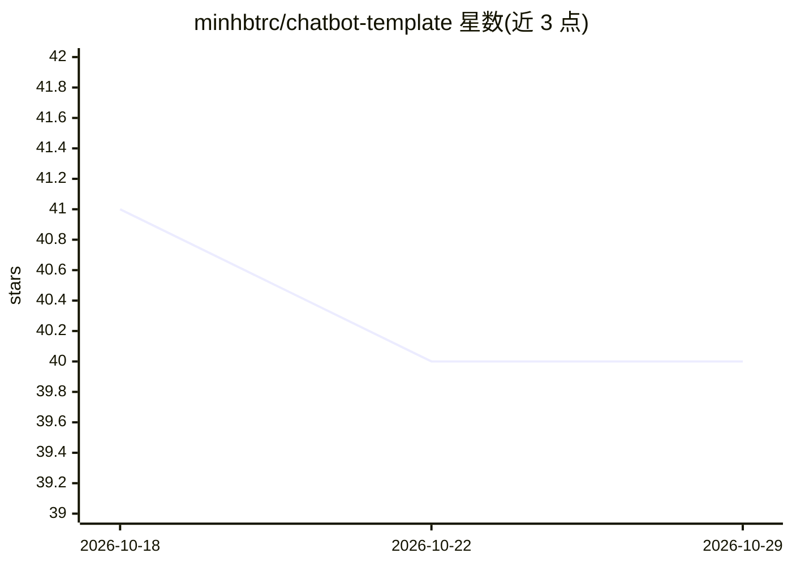

# minhbtrc/chatbot-template

⭐ 40 · Python · MIT · 推送 2025-11-22 · [GitHub](https://github.com/minhbtrc/chatbot-template) · 个人维护

**构建 LLM 聊天应用的模块化后端框架**

基于 FastAPI 与依赖注入的后端框架，供开发者构建由 LLM 驱动的聊天应用。提供三种专家模式：QNA 基础问答、带 PDF 处理与向量存储的 RAG、带网页搜索的 DeepResearch。支持多种 LLM 提供商（OpenAI、Azure OpenAI、Gemini、LlamaCpp、Vertex AI）与 SSE 流式响应；记忆后端可选内存、MongoDB 或 SQL。安装方式为 git clone 源码加 uv 管理依赖，需 Python 3.12+；MongoDB 为可选依赖；提供 CLI 三种模式与 Docker 部署（make docker-build）。采用 Clean Architecture 分层，MIT 许可。

## 筛选速览

| 维度 | 判定 | 备注 |
|---|---|---|
| AI 角色 | `ai-ecosystem` | LLM/agent 周边工具 |
| 许可风险 | `permissive` | MIT |
| 部署形态 | `None` |  |
| 模型依赖 | locked-api |  |
| 硬件要求 | — | 无带数字的原话,不猜 |
| 安装摩擦 | `low` | 无编译、无系统依赖或容器化 |
| 成熟度 | — | 结构信号不足 |

## 能力要点

- 三种专家模式：QNA / RAG / DeepResearch（网页搜索）
- 多 LLM 提供商接入（OpenAI、Azure OpenAI、Gemini、LlamaCpp、Vertex AI）
- SSE 流式响应与可插拔记忆后端（内存/MongoDB/SQL）
- REST API（含 RAG 文档上传、专家切换）与 CLI 双入口

## 适用场景

- 快速搭建带 RAG 的文档问答后端
- 构建可切换模型提供商的聊天机器人服务
- 用 CLI 模式本地调试 QNA/RAG/DeepResearch 机器人

## 场景标签

`Agent 框架` `RAG` · 领域:Agent 开发

## 证据(README 行号)

> L3: A modular, production-ready backend framework for building AI chat applications powered by large language models (LL
> L164: - **Experts**: Specialized AI assistants (QNA, RAG, DeepResearch)

## 星数曲线

2026-10-18 41 → 2026-10-29 40（-1）

---
*卡片 v1 · prompt 1.4 · 生成 2026-10-25 · 置信度 high · 依据 README sha `4f96ecb95701` · [字段定义](../../DATASET.md)*
