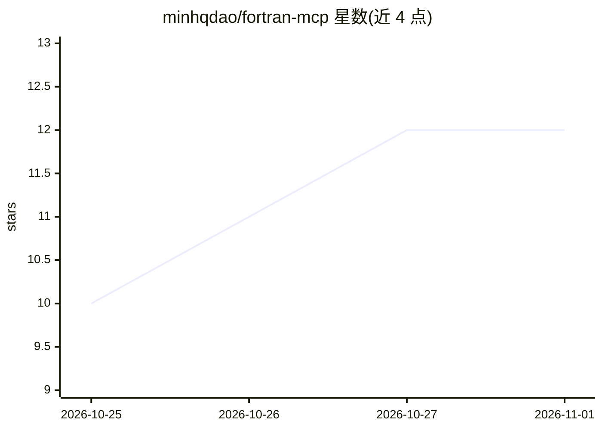

# minhqdao/fortran-mcp

⭐ 12 · Python · MIT · 推送 2026-10-29 · [GitHub](https://github.com/minhqdao/fortran-mcp) · 个人维护

**为 AI 编程助手提供带引用的 Fortran 文档检索 MCP 服务器**

本地运行的 MCP 服务器，向 AI 编程助手（Claude Code、Codex、OpenCode）提供经策展的 Fortran 文档检索：支持词法、语义与混合三种搜索模式，返回带来源归属、版本信息与原文链接的段落。数据包按固定修订版收录 20+ 个 Fortran 文档源，首运行自动安装或可用 CLI 预先下载。需 Python 3.11+ 与 uv，通过 uv tool 安装，提供 stdio 与 HTTP 两种服务模式；语义/混合搜索需安装附加依赖。

## 筛选速览

| 维度 | 判定 | 备注 |
|---|---|---|
| AI 角色 | `ai-ecosystem` | LLM/agent 周边工具 |
| 许可风险 | `permissive` | MIT |
| 部署形态 | `library` | 以包/库形式分发 |
| 模型依赖 | locked-api |  |
| 硬件要求 | — | 无带数字的原话,不猜 |
| 安装摩擦 | `medium` | 含编译或系统依赖之一 |
| 成熟度 | — | 结构信号不足 |

## 能力要点

- 词法/语义/混合三种搜索模式，结果带来源归属与版本信息
- 20+ 个固定修订版的 Fortran 文档源（fpm、GNU Fortran、Fortran-lang、OpenMP 等）
- 支持 Claude Code / Codex / OpenCode 客户端接入
- 提供 stdio 与 HTTP 两种服务模式及数据包管理 CLI

## 适用场景

- 让 Claude Code 等 AI 编程助手在写 Fortran 时引用权威文档
- 查找 Fortran 语言特性、编译器行为与构建系统的原文出处
- 本地搭建 Fortran 文档检索服务供编码助手调用

## 场景标签

`语义搜索` · 领域:知识与检索

## 证据(README 行号)

> L11: Use Fortran MCP to improve AI-assisted Fortran development with cited documentation on language features, compiler 
> L44:  Claude Code
> L114: |`fortran-mcp`|Start the stdio MCP server.|

## 星数曲线

2026-10-25 10 → 2026-11-01 12（+2）

---
*卡片 v1 · prompt 1.4 · 生成 2026-11-01 · 置信度 high · 依据 README sha `5659907055ae` · [字段定义](../../DATASET.md)*
