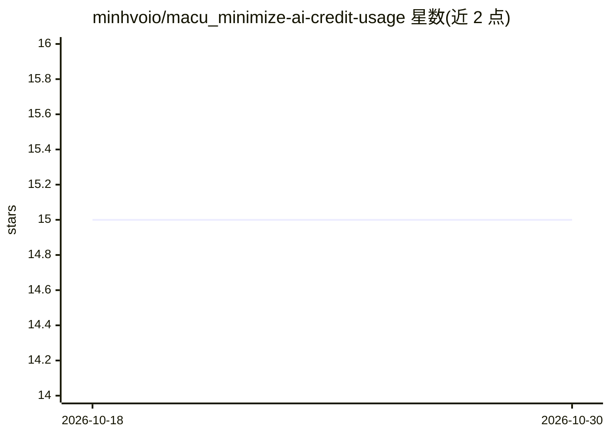

# minhvoio/macu_minimize-ai-credit-usage

⭐ 15 · JavaScript · MIT · 推送 2026-04-27 · [GitHub](https://github.com/minhvoio/macu_minimize-ai-credit-usage) · 个人维护

**分析 Claude Code/OpenCode/Codex 工具调用记录，找出未使用的 MCP 工具以减少 token 开销**

面向 AI 编程工具（Claude Code、OpenCode、Codex）用户的 CLI 工具：自动探测并读取本地工具调用历史（JSONL/SQLite），统计每个工具的调用频率、闲置天数与每条消息的 token 定义开销，输出未使用/低使用工具清单、Projected token overhead 图表，以及按配置文件分组的可合并 JSON 禁用片段（Conservative/Aggressive 两档）。编辑配置的优化步骤设计为由 AI agent 执行，macu 本身只做分析与建议，修改前生成 .bak 备份。通过 npm/npx 或 curl 安装脚本安装，新增数据源只需实现 probe/load 两个导出的 adapter 文件。

## 筛选速览

| 维度 | 判定 | 备注 |
|---|---|---|
| AI 角色 | `ai-ecosystem` | LLM/agent 周边工具 |
| 许可风险 | `permissive` | MIT |
| 部署形态 | `library` | 以包/库形式分发 |
| 模型依赖 | — | README 未给出锁定关系 |
| 硬件要求 | — | 无带数字的原话,不猜 |
| 安装摩擦 | `low` | 无编译、无系统依赖或容器化 |
| 成熟度 | — | 结构信号不足 |

## 能力要点

- 自动探测并合并 Claude Code/OpenCode/Codex 三种来源的本地调用记录，零配置
- 按闲置天数给出置信度标签（Conservative/Aggressive 两档禁用建议）
- 输出可直接合并进 opencode.json 等配置的 JSON 禁用片段
- 无法定位来源的工具标记 removed/unknown 并拒绝给出禁用指令

## 适用场景

- 订阅额度消耗过快时排查 MCP 工具定义带来的 token 开销
- 清理长期未使用的 MCP 工具与插件
- 在 AI 编程会话中让 agent 依据行动方案直接修改配置并复跑验证

## 场景标签

`LLM 可观测性` · 领域:评测与运维

## 证据(README 行号)

> L45: It reads your actual tool-call history from Claude Code, OpenCode, or Codex - then shows you:
> L214: |Source|Format|Auto-detected Location|

## 星数曲线

2026-10-18 15 → 2026-10-30 15（+0）

---
*卡片 v1 · prompt 1.4 · 生成 2026-10-30 · 置信度 high · 依据 README sha `0f2c4abe78b0` · [字段定义](../../DATASET.md)*
