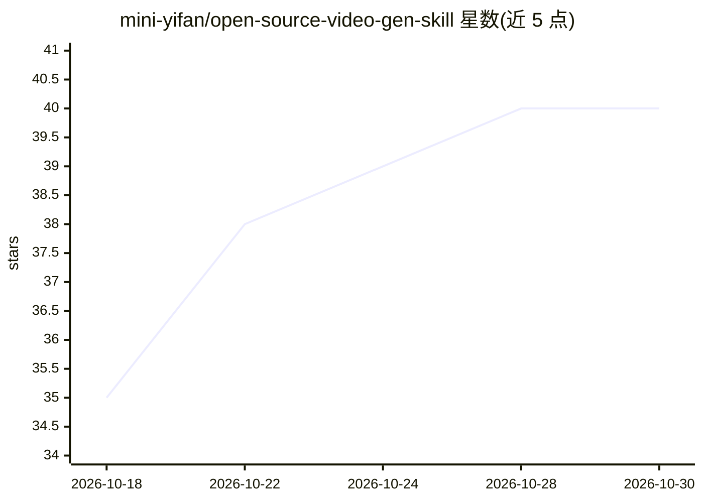

# mini-yifan/open-source-video-gen-skill

⭐ 40 · Python · NOASSERTION · 推送 2026-09-11 · [GitHub](https://github.com/mini-yifan/open-source-video-gen-skill) · 个人维护 · 中文 README

**给创作者：一句话想法经 Agent 技能集自动生成成片**

开源 AI 视频制片技能集：由 9 个 Agent 技能组成，覆盖提示词写作、MiniMax H3 云端视频生成、GPU 服务器自动开关机、三视图/图片生成、配乐与 TTS 配音；两套成片模板（美女时尚单片、短剧/成片）通过确认关卡与断点续作组织流程。MiniMax H3 部署在 AutoDL 的 ComfyUI 实例上，用户付 GPU 租金，README 给出 10 秒 1080p 约 ¥0.3 的量级参考。运行需 Agent 运行时（ZCode 等）、AutoDL 账号与 Token，以及本地 ffmpeg/python3/node 等工具。

## 筛选速览

| 维度 | 判定 | 备注 |
|---|---|---|
| AI 角色 | `ai-native` | 本体是模型或模型工具 |
| 许可风险 | `none` | NOASSERTION |
| 部署形态 | `None` |  |
| 模型依赖 | — | README 未给出锁定关系 |
| 硬件要求 | — | 无带数字的原话,不猜 |
| 安装摩擦 | `medium` | 含编译或系统依赖之一 |
| 成熟度 | — | 结构信号不足 |

## 能力要点

- 9 个技能可独立使用或由模板调度
- Agent 管理 AutoDL GPU 服务器开机与关机
- 模板含确认关卡、断点续作与目录规范
- doctor.sh 一键自检凭证与工具

## 适用场景

- 用一句话生成十几秒的单条视频
- 按确认关卡流程制作多集竖屏短剧或宣传片
- 生成角色三视图、配乐与配音等单项素材

## 场景标签

`视频生成` `图像生成` `语音合成` · 领域:内容生成

## 证据(README 行号)

> L3: **开源 AI 视频制片技能集** · 开源模型 MiniMax H3 × AutoDL 弹性 GPU × Agent 全自动制片
> L60: |`minimax-h3`|云端生成视频：工作流发现、素材上传、提交、轮询、下载|

## 星数曲线

2026-10-18 35 → 2026-10-30 40（+5）

---
*卡片 v1 · prompt 1.4 · 生成 2026-10-25 · 置信度 high · 依据 README sha `bccc3af68f58` · [字段定义](../../DATASET.md)*
