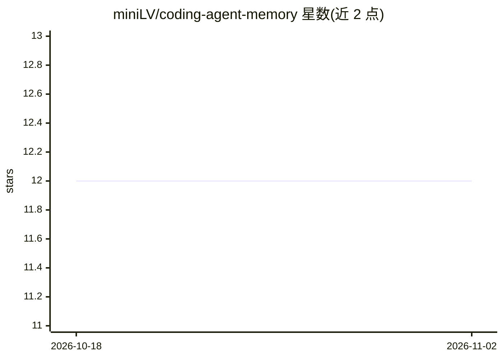

# miniLV/coding-agent-memory

⭐ 12 · JavaScript · Apache-2.0 · 推送 2026-10-09 · [GitHub](https://github.com/miniLV/coding-agent-memory) · 个人维护 · 中文 README

**把 Codex/Claude Code 本机会话编译成可审计 Markdown 记忆库**

面向 Codex 与 Claude Code 用户的本地工程记忆工具：读取本机会话日志（~/.codex/sessions/、~/.claude/projects/ 及自定义文件夹），生成有界 Evidence Snapshot 并编译成 Daily Wiki，Weekly Review 将反复出现的主题晋升为 Concept，再通过 engineering-memory-loader 在新任务中按 key 召回历史结论。全部内容为普通 Markdown，可用 Git 管理，不依赖向量数据库或托管服务。定时执行当前仅支持 Codex App Automations，同一 vault 只允许一个 runner 写入。

## 筛选速览

| 维度 | 判定 | 备注 |
|---|---|---|
| AI 角色 | `ai-ecosystem` | LLM/agent 周边工具 |
| 许可风险 | `permissive` | Apache-2.0 |
| 部署形态 | `None` |  |
| 模型依赖 | — | README 未给出锁定关系 |
| 硬件要求 | — | 无带数字的原话,不猜 |
| 安装摩擦 | `low` | 无编译、无系统依赖或容器化 |
| 成熟度 | `idea` | |

## 能力要点

- 会话→Evidence Snapshot→Daily Wiki→Concept 的两级记忆流水线
- Key-driven synthesis 支持以 ticket id、repo、alias 等 key 串联历史
- 纯本地 Markdown，可审计、可 Git 管理，无需向量数据库
- 内置合成 fixture 的可复现验证（node --test + 严格 wiki lint）

## 适用场景

- 新任务中召回以前调查过的结论、命令和失败原因
- 把个人工程经验沉淀为可审计的 Markdown Wiki
- 避免 AI 助手重复调查已解决的问题

## 场景标签

`Agent 记忆` `知识库管理` · 领域:Agent 开发

## 证据(README 行号)

> L21: AI 编程助手每次开启新任务，都可能重复调查你已经解决过的问题。这个项目把 Codex / Claude Code 的本机会话整理成一个 Markdown Wiki，再通过 `engineering-memory-loader` 
> L161: Coding Agent Memory 在 Codex 中的查询示例

## 星数曲线

2026-10-18 12 → 2026-11-02 12（+0）

---
*卡片 v1 · prompt 1.4 · 生成 2026-11-01 · 置信度 high · 依据 README sha `3ee56e36a658` · [字段定义](../../DATASET.md)*
