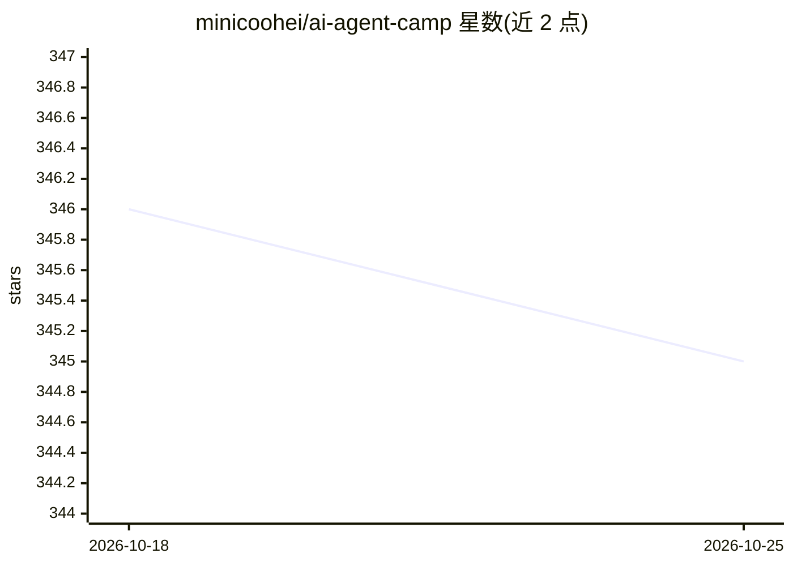

# minicoohei/ai-agent-camp

⭐ 346 · Python · 推送 2026-10-07 · [GitHub](https://github.com/minicoohei/ai-agent-camp) · [官网](https://ai-agent.camp) · 个人维护

**面向非工程师的 AI Agent 实训课程仓库（Claude Code/Cursor/Codex）**

面向市场营销、销售、企划、行政等无编程经验岗位的 AI agent 培训教材仓库：以 Claude Code、Cursor、Codex 三种编码工具为学习载体，提供 62 个课程章节、138 个可运行 start-* 课程、技能与命令参考及业务工作流模板（客服、销售、内容营销、入职自动化等），预计学习时长 50-60 小时。仓库提供完整性校验脚本防范 fork 篡改、密钥管理指南与安全护栏文档；通过 git clone 下载，用 uv 安装 Python 依赖，另有配套官网 ai-agent.camp 的 47 模块网页课程。

## 筛选速览

| 维度 | 判定 | 备注 |
|---|---|---|
| AI 角色 | `ai-knowledge` | 知识聚合/清单类 |
| 许可风险 | `none` | — |
| 部署形态 | `desktop` | 安装包/桌面程序 |
| 模型依赖 | — | README 未给出锁定关系 |
| 硬件要求 | — | 无带数字的原话,不猜 |
| 安装摩擦 | `low` | 无编译、无系统依赖或容器化 |
| 成熟度 | `idea` | |

## 能力要点

- 62 个课程章节、138 个可运行 start-* 课程，预计 50-60 小时
- 同时支持 Claude Code / Cursor / Codex 三种工具入口（含工具对比表）
- 含 fork 完整性校验脚本、API key 管理与安全护栏文档
- 覆盖 Google Workspace、Slack、Notion、GitHub Actions 等集成实践模块

## 适用场景

- 非技术岗位人员系统学习用 Claude Code/Cursor/Codex 自动化日常工作
- 团队整体提升 AI 素养的培训教材
- 通过 start-* 课程练习横幅生成、数据分析、PPT 编辑等业务技能

## 场景标签

`教程课程` · 领域:学习与行业

## 证据(README 行号)

> L71: **ai-agent-camp** is a comprehensive training resource for **non-engineering roles** such as marketing, sales, plan
> L97:  - Official web catalog at ai-agent.camp (as of 2026-08-31): **47 modules**, FAQ study time about **50–60 hours**

## 星数曲线

2026-10-18 346 → 2026-10-25 345（-1）

---
*卡片 v1 · prompt 1.4 · 生成 2026-10-21 · 置信度 high · 依据 README sha `b9cf00e7c7e5` · [字段定义](../../DATASET.md)*
