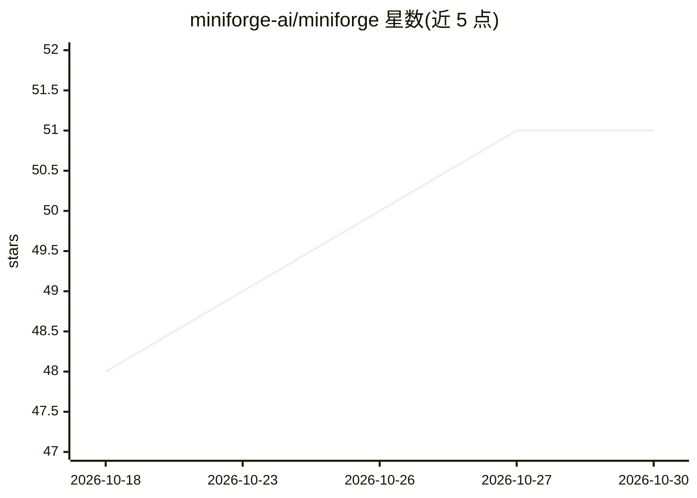

# miniforge-ai/miniforge

⭐ 51 · Clojure · Apache-2.0 · 推送 2026-10-29 · [GitHub](https://github.com/miniforge-ai/miniforge) · 组织维护

**自主软件工厂：写需求规格，自动产出通过测试的 PR**

面向开发者的自主软件开发系统：用户以英文或 EDN 编写 spec，系统由一组专门化 agent 按 explore→plan→implement→verify→review→release→observe 阶段协作，生成代码、跑测试、自查并开 PR；发布后监控循环可持续 72 小时自动处理评审意见直至合并。四层嵌套控制环加 meta-agent 治理，策略门禁与 token/成本/时间硬预算约束每步转换，所有决策产出证据链。LLM 后端经 OpenCode 接入 Claude Code、Codex CLI 等，容器运行时默认 Podman、支持 Docker。端到端流程目前在 Clojure 项目上可用。

## 筛选速览

| 维度 | 判定 | 备注 |
|---|---|---|
| AI 角色 | `ai-ecosystem` | LLM/agent 周边工具 |
| 许可风险 | `permissive` | Apache-2.0 |
| 部署形态 | `None` |  |
| 模型依赖 | — | README 未给出锁定关系 |
| 硬件要求 | — | 无带数字的原话,不猜 |
| 安装摩擦 | `low` | 无编译、无系统依赖或容器化 |
| 成熟度 | — | 结构信号不足 |

## 能力要点

- 四层嵌套控制环：团队循环、内循环修复、72 小时 PR 监控、meta-agent 治理
- 策略门禁（语法/lint/密钥/测试/覆盖率）与 token/成本/时间硬预算
- 规格可写为 Clojure EDN 或带 YAML frontmatter 的 Markdown
- DAG 执行器在隔离 worktree 中并行运行任务，每任务独立预算

## 适用场景

- 写一份 spec 让系统自动实现功能、跑测试并开 PR
- 小改动走 Quick Fix 工作流快速完成
- 发布后让监控循环自动回应评审意见并尝试合并

## 场景标签

`编码 Agent` `多智能体` · 领域:Agent 开发

## 证据(README 行号)

> L7: Miniforge is an autonomous software factory. You describe what you want — in
> L82: - An LLM backend: OpenCode CLI, Claude Code
> L23: Miniforge runs four nested control loops — a team of agents does the work,

## 星数曲线

2026-10-18 48 → 2026-10-30 51（+3）

---
*卡片 v1 · prompt 1.4 · 生成 2026-10-24 · 置信度 high · 依据 README sha `b12648a75bf7` · [字段定义](../../DATASET.md)*
