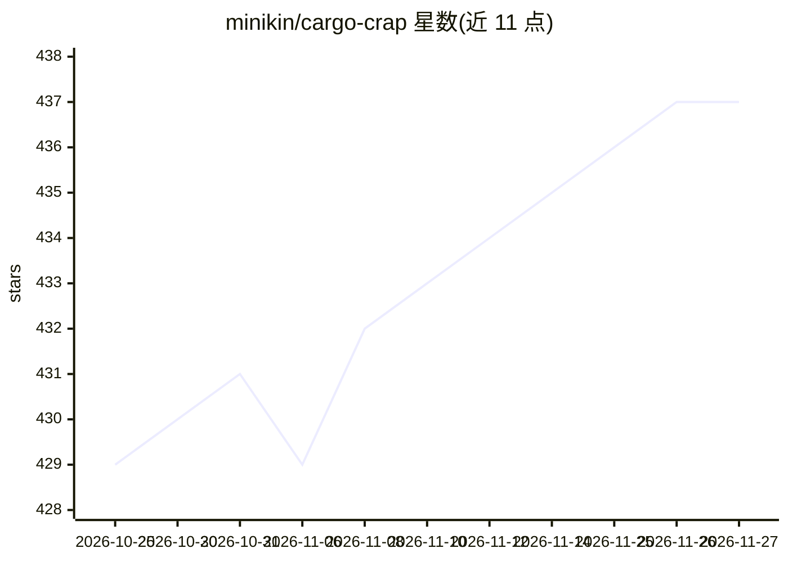

# minikin/cargo-crap

⭐ 437 · Rust · MIT · 推送 2026-11-26 · [GitHub](https://github.com/minikin/cargo-crap) · 个人维护

**为 Rust/TS/JS 代码计算 CRAP 分数并找出复杂未测函数**

提供 cargo-crap（Rust，syn 解析）与 crapts（TypeScript/JavaScript，oxc 解析）两个工具，按 CRAP 公式（圈复杂度与覆盖率）给函数打分，读取 LCOV 或 Istanbul 覆盖率文件，不自行运行测试。支持终端表格、markdown、pr-comment、SARIF 等输出格式，可在 CI 中按阈值或基线回归使构建失败，GitHub Action 可在 PR 上发布增量评论。另提供结构性重复函数分组与可选的 LLM triage（TypeSafe 或 OpenAI，需配置开关与 API key），以及六项可维护性结构信号。

## 筛选速览

| 维度 | 判定 | 备注 |
|---|---|---|
| AI 角色 | `ai-enhanced` | 去掉 AI 部分产品仍成立 |
| 许可风险 | `permissive` | MIT |
| 部署形态 | `library` | 以包/库形式分发 |
| 模型依赖 | — | README 未给出锁定关系 |
| 硬件要求 | — | 无带数字的原话,不猜 |
| 安装摩擦 | `low` | 无编译、无系统依赖或容器化 |
| 成熟度 | — | 结构信号不足 |

## 能力要点

- 读取 LCOV/Istanbul 覆盖率文件计算函数级 CRAP 分数，不运行测试
- CI 门禁：按阈值失败、基线回归失败、PR 增量评论与 SARIF 上传
- 结构性重复函数分组，可选 TypeSafe/OpenAI triage（需配置与 API key）
- 六项结构信号（嵌套深度、长度、bumps、复杂条件、stub、panic 位点）

## 适用场景

- 在 CI 中拦截覆盖率下降或复杂度上升的函数变更
- 找出 AI 生成代码中复杂且无测试的函数
- 对比分支与 main，门禁仅针对被改动的函数
- 对重复函数分组并判定哪些值得合并

## 场景标签

 · 领域:开发者工具/代码质量

## 证据(README 行号)

> L18: cargo-crap and crapts find the functions that are both complex and
> L200: Triage sends both function bodies to the provider you pick, so it stays off
> L232: `--format json` carries the same reasons for coding agents to act on.

## 星数曲线

2026-10-25 429 → 2026-11-27 437（+8）

---
*卡片 v1 · prompt 1.4 · 生成 2026-11-27 · 置信度 high · 依据 README sha `594ca80eeae0` · [字段定义](../../DATASET.md)*
