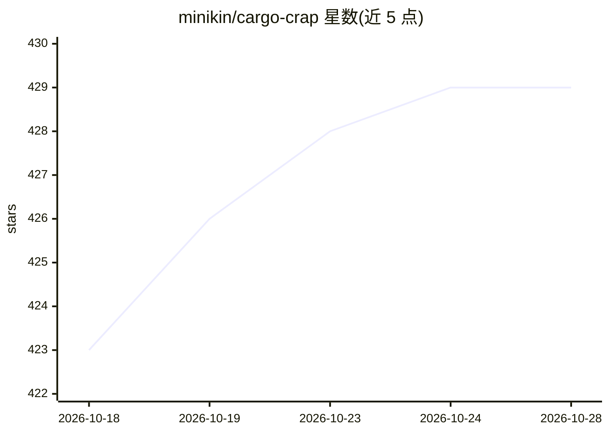

# minikin/cargo-crap

⭐ 429 · Rust · MIT · 推送 2026-10-28 · [GitHub](https://github.com/minikin/cargo-crap) · [官网](https://crates.io/crates/cargo-crap) · 个人维护

**Rust 项目的 CRAP 变更风险度量 cargo 插件**

面向 Rust 开发者的静态分析工具：用 syn 解析源码，读取覆盖率工具输出的 LCOV 文件，按 CRAP 公式（圈复杂度平方×未覆盖率立方+复杂度）为每个函数打分，本地查看测试缺口或在 CI 中按阈值与回归门禁拦截构建。另提供重复函数检测（可选 TypeSafe 或 OpenAI 模型做分类裁决）与六项结构信号（嵌套深度、stub、panic 位点等）回归检测。不运行测试，依赖外部覆盖率工具（如 cargo-llvm-cov）生成 LCOV。提供 GitHub Action、SARIF 上传与多种输出格式。

## 筛选速览

| 维度 | 判定 | 备注 |
|---|---|---|
| AI 角色 | `ai-enhanced` | 去掉 AI 部分产品仍成立 |
| 许可风险 | `permissive` | MIT |
| 部署形态 | `library` | 以包/库形式分发 |
| 模型依赖 | — | README 未给出锁定关系 |
| 硬件要求 | — | 无带数字的原话,不猜 |
| 安装摩擦 | `low` | 无编译、无系统依赖或容器化 |
| 成熟度 | — | 结构信号不足 |

## 能力要点

- 基于圈复杂度与行覆盖率计算 CRAP 分数，支持阈值与回归门禁
- 结构重复函数分组检测，可选 TypeSafe/OpenAI 模型分类裁决（是否值得合并）
- 六项结构信号（嵌套深度、长度、todo!/panic 位点等）的回归检测
- 提供 GitHub Action、PR 评论、SARIF 上传与 JSON 输出

## 适用场景

- 找出复杂且缺乏测试覆盖的 Rust 函数
- 在 CI 中当 CRAP 分数超阈值或回归时使构建失败
- 检测并分类处理重复实现的函数
- 为编码 agent 输出 JSON 格式的可维护性问题

## 场景标签

 · 领域:开发工具/代码质量

## 证据(README 行号)

> L15: cargo-crap finds the Rust functions that are both complex and untested: the
> L118: triage on, a model from TypeSafe (the default)
> L162: `--format json` carries the same reasons for coding agents to act on.

## 星数曲线

2026-10-18 423 → 2026-10-28 429（+6）

---
*卡片 v1 · prompt 1.4 · 生成 2026-10-22 · 置信度 high · 依据 README sha `720d5eaf2919` · [字段定义](../../DATASET.md)*
