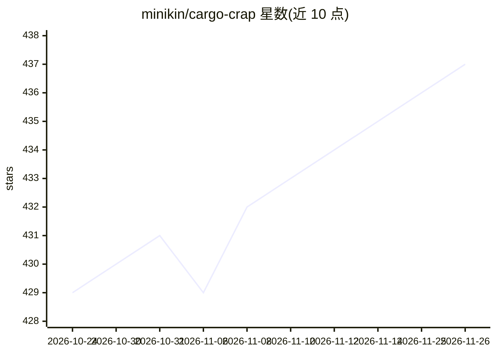

# minikin/cargo-crap

⭐ 437 · Rust · MIT · 推送 2026-11-25 · [GitHub](https://github.com/minikin/cargo-crap) · 个人维护

**给 Rust 与 TS/JS 代码计算 CRAP 分数，定位复杂且未测试的函数**

cargo-crap 与 crapts 为 Rust、TypeScript 和 JavaScript 计算 CRAP 指标（圈复杂度与行覆盖率的组合公式），读取 LCOV 或 Istanbul 覆盖文件，输出按分数排序的函数表格，并支持 CI 中以基线或阈值拦截回归。可选功能包括结构重复函数分组、六个结构信号度量、uncovered 行提示，以及用 LLM（TypeSafe 默认或 OpenAI）对重复组做三类问题的分诊；分诊默认关闭，需配置文件与 API key 启用，不影响分数与退出码。

## 筛选速览

| 维度 | 判定 | 备注 |
|---|---|---|
| AI 角色 | `ai-enhanced` | 去掉 AI 部分产品仍成立 |
| 许可风险 | `permissive` | MIT |
| 部署形态 | `library` | 以包/库形式分发 |
| 模型依赖 | — | README 未给出锁定关系 |
| 硬件要求 | — | 无带数字的原话,不猜 |
| 安装摩擦 | `low` | 无编译、无系统依赖或容器化 |
| 成熟度 | — | 结构信号不足 |

## 能力要点

- CRAP 公式（comp²×(1−cov/100)³+comp）结合圈复杂度与覆盖率评分
- 读取 cargo-llvm-cov、tarpaulin、Vitest、Jest、nyc、c8 生成的 LCOV/Istanbul 覆盖文件
- GitHub Action 一步接入：PR 评论 delta、job summary 报告、SARIF 上传
- 结构重复分组与可选的 LLM 分诊（TypeSafe/OpenAI，需配置与 API key）

## 适用场景

- 在 CI 中拦截分数超阈值或上升的变更函数
- 找出 Rust 或 TS/JS 项目中复杂且缺测试的函数
- 将重复代码分组并借助 LLM 判断是否值得合并
- 为编码 agent 输出 JSON 格式的结构问题清单

## 场景标签

 · 领域:开发者工具/代码质量

## 证据(README 行号)

> L18: cargo-crap and crapts find the functions that are both complex and
> L22: with `oxc`. Run either locally to see where tests are missing, or in CI to
> L200: Triage sends both function bodies to the provider you pick, so it stays off

## 星数曲线

2026-10-24 429 → 2026-11-26 437（+8）

---
*卡片 v1 · prompt 1.4 · 生成 2026-11-26 · 置信度 high · 依据 README sha `91befef8ee03` · [字段定义](../../DATASET.md)*
