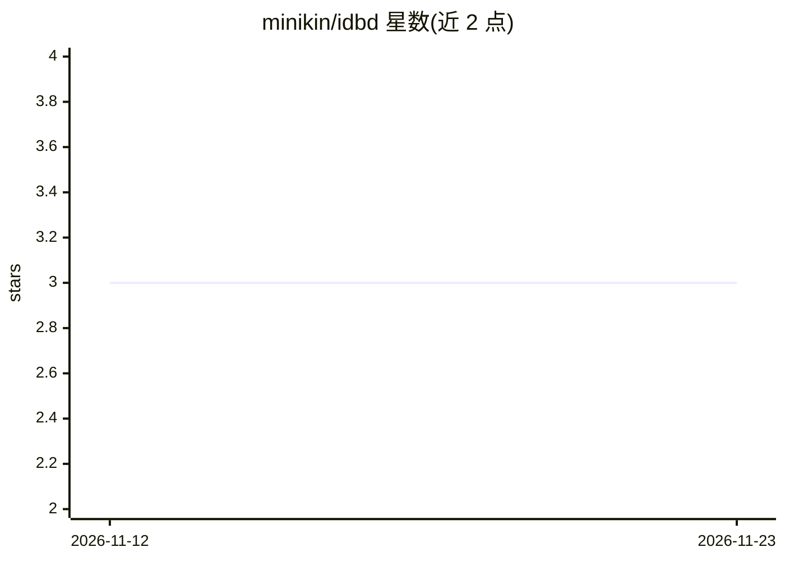

# minikin/idbd

⭐ 3 · Rust · Apache-2.0 · 推送 2026-11-22 · [GitHub](https://github.com/minikin/idbd) · [官网](https://idbd.minikin.me) · 个人维护

**为在线学习者提供逐输入自适应步长的 Rust 库**

该仓库提供 IDBD（Sutton, 1992）与 Autostep（Mahmood et al., 2012）的 Rust 实现：为每个输入维护独立学习率并按平方误差梯度调整，更新路径无内存分配、失败时返回类型化错误且保持原状态。仓库含三部分：无依赖的 crate、按记录种子复现论文实验的 idbd-lab，以及经 WebAssembly 在浏览器运行的故事页与 Explorer 演示。需要 Rust 1.85 及以上；结果在合成任务上生成，README 说明不推广到一般情形。

## 筛选速览

| 维度 | 判定 | 备注 |
|---|---|---|
| AI 角色 | `ai-native` | 本体是模型或模型工具 |
| 许可风险 | `permissive` | Apache-2.0 |
| 部署形态 | `None` |  |
| 模型依赖 | — | README 未给出锁定关系 |
| 硬件要求 | — | 无带数字的原话,不猜 |
| 安装摩擦 | `low` | 无编译、无系统依赖或容器化 |
| 成熟度 | — | 结构信号不足 |

## 能力要点

- IDBD 与 Autostep 实现：每个输入一个自适应步长
- 无依赖、无 unsafe、更新路径无内存分配
- 论文实验的种子化复现，结果可逐字节重现
- 通过 WebAssembly 在浏览器提供可交互演示

## 适用场景

- 在流式数据上为每个输入自适应调整学习率
- 复现或教学 IDBD/Autostep 在线学习算法
- 在浏览器中交互式理解逐输入步长的机制

## 场景标签

`教程课程` · 领域:学习与行业

## 证据(README 行号)

> L9: IDBD (Sutton, 1992) is the LMS rule with one learning rate per input. It keeps
> L23: - `idbd`, the crate: IDBD and Autostep (Mahmood et al., 2012) as checked, atomic,
> L24:  allocation-free online learners. No dependencies, no `unsafe`, Rust 1.85 or newer.

## 星数曲线

2026-11-12 3 → 2026-11-23 3（+0）

---
*卡片 v1 · prompt 1.4 · 生成 2026-11-21 · 置信度 high · 依据 README sha `a8cd76321c92` · [字段定义](../../DATASET.md)*
