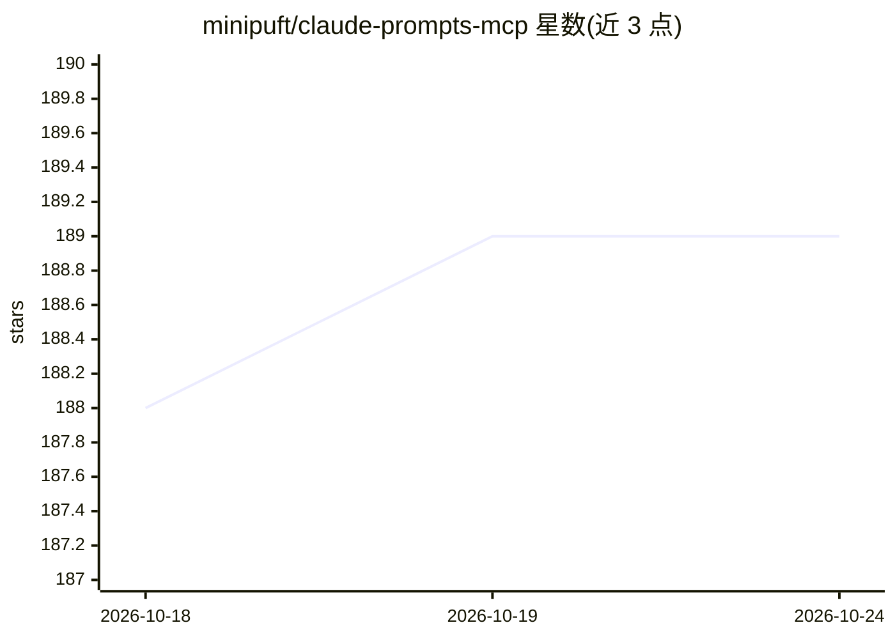

# minipuft/claude-prompts-mcp

⭐ 189 · TypeScript · MIT · 推送 2026-10-22 · [GitHub](https://github.com/minipuft/claude-prompts-mcp) · [官网](https://github.com/minipuft/claude-prompts-mcp/tree/main/docs) · 个人维护

**给 AI 编码客户端加可复用提示词模板与工作流的 MCP 服务器**

面向使用 Claude Code、Cursor、OpenCode、Gemini CLI 等 AI 编码客户端的开发者的 MCP 服务器：提供四类原语（提示词模板 >>、验证门 ::、推理框架 @、样式 #），用操作符语法组合多步链式工作流，步骤间可运行自评估或 shell 命令验证（如 npm test），失败可重试。内置 52 个提示词，通过三个 MCP 工具（prompt_engine / resource_manager / system_control）暴露，支持热重载与版本回滚；可将 YAML 模板导出为客户端原生 skill。带插件钩子的客户端（Claude Code、OpenCode）获得对话内操作符与链式状态保持，Codex 插件为实验性。以 npm/npx、.mcpb 包或源码方式安装。

## 筛选速览

| 维度 | 判定 | 备注 |
|---|---|---|
| AI 角色 | `ai-ecosystem` | LLM/agent 周边工具 |
| 许可风险 | `permissive` | MIT |
| 部署形态 | `library` | 以包/库形式分发 |
| 模型依赖 | — | README 未给出锁定关系 |
| 硬件要求 | — | 无带数字的原话,不猜 |
| 安装摩擦 | `low` | 无编译、无系统依赖或容器化 |
| 成熟度 | `idea` | |

## 能力要点

- 四原语操作符语法组合多步工作流（提示词/验证门/框架/样式）
- 步骤间验证门：AI 自评估或 shell 命令（verify:"npm test"）校验，失败自动重试
- 内置 52 个提示词模板，支持热重载、版本管理与回滚
- YAML 模板可导出为 Claude Code / Cursor / Codex / OpenCode 原生 skill

## 适用场景

- 把重复编写的提示词沉淀为团队可复用的版本化模板
- 为 AI 编码客户端构建带中途校验的多步工作流（如实现-测试-修复循环）
- 在多个 AI 客户端间共享同一套提示词与工作流定义

## 场景标签

`提示工程` · 领域:Agent 开发

## 证据(README 行号)

> L5: **The portable workflow layer beside your AI coding harness.**
> L7:  Your client executes with its own tools, agents, and context.
> L33: - **Works with** Claude Code, Claude Desktop, Cursor, OpenCode, Gemini CLI, Codex, Windsurf, and Zed. Plugin instal

## 星数曲线

2026-10-18 188 → 2026-10-24 189（+1）

---
*卡片 v1 · prompt 1.4 · 生成 2026-10-23 · 置信度 high · 依据 README sha `f867cbf4fcba` · [字段定义](../../DATASET.md)*
